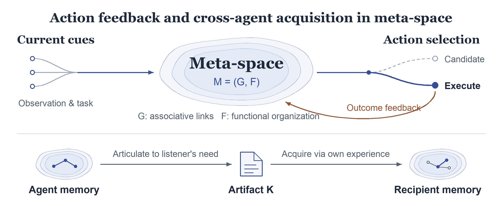
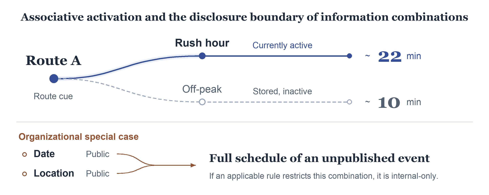
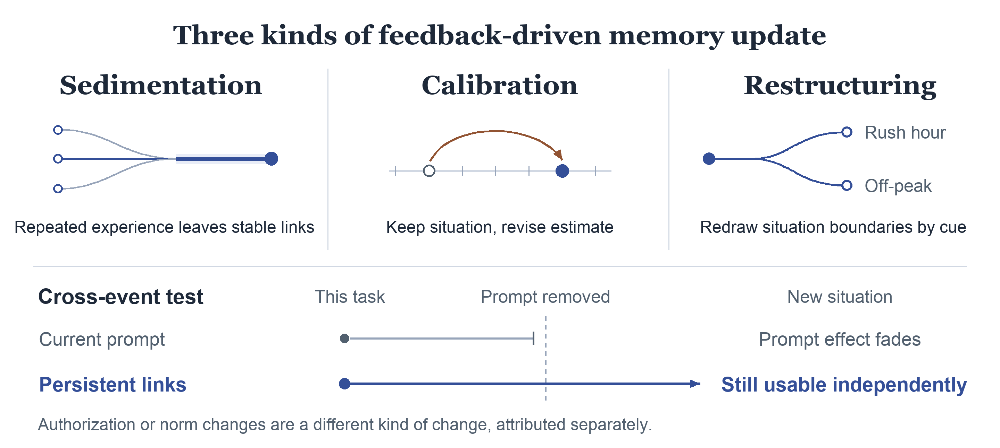
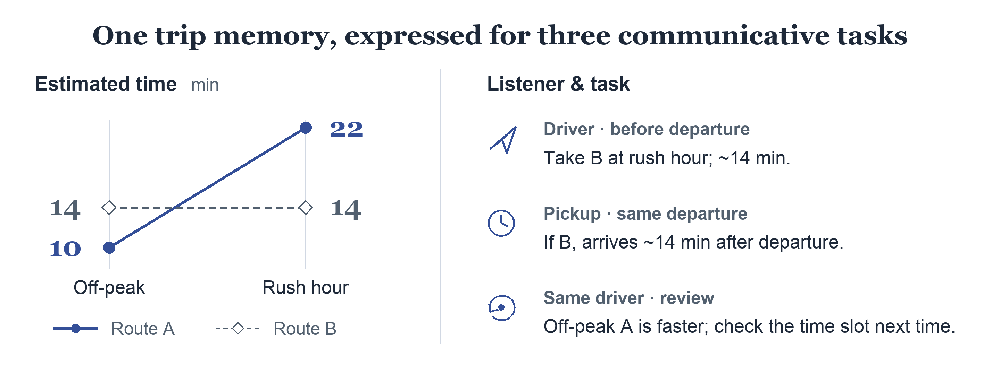

# Generative Memory Theory: How Agents Construct Memory in Meta-Space to Generate Intelligent Behavior

**Abstract:** How does an agent recognize a situation, anticipate its consequences, and choose an action when no ready-made answer is available? Generative Memory Theory (GMT) defines **meta-space** as the functional setting in which an agent continually develops its capabilities. Within this setting, the agent organizes experience from digital and physical environments into structures that guide perception, imagination, and action. We call these structures **generative memory**. Existing memory informs present judgment; feedback from action can, in turn, revise that memory. Memory also shapes what an agent says. Even when facts and permissions are held constant, what the listener already knows, the decision they face, and the purpose of the conversation can lead the agent to select different facts, reasons, or recommendations from the same memory. We call this **contextual articulation**. Formal disclosure rules constrain that selection where applicable. In **acquisition**, a recipient draws on prior abilities, demonstrations, or practice to develop judgments that persist and transfer; repeating an explanation does not establish that the underlying capability has transferred. GMT advances the hypothesis that generative memory is necessary for intelligent behavior. We present a functional model, eight research propositions, a reference architecture, and an evaluation design for investigating this hypothesis about general intelligence.

**Keywords:** generative memory; meta-space; memory construction; contextual articulation; prospective simulation; acquisition; artificial general intelligence

## 1 Introduction

### 1.1 Why can an agent have knowledge and still not act?

The first time a person steps onto a slippery slope, a slight slip underfoot may shorten their stride. Past experience did not store an answer to "how far should the next step be on this slope," yet it may change the cues the person notices, the consequences they anticipate, and the actions they are willing to take. What needs explaining here is not how an old answer is retrieved, but how the past participates in producing a new choice.

For artificial agents, the same question is often obscured by the availability of knowledge. Belief–desire–intention architectures organize reasons for action [26-27]; ontologies and rules characterize domain knowledge [30,33]; retrieval-augmented generation (RAG) lets models consult external documents [38]; tool learning connects reasoning to environmental operation [36-37]. These methods solve different problems. What GMT questions is the inference from "the system has acquired a correct description" to "the system already possesses the corresponding competence": given the same manual, why can a novice and an expert both follow the rules, yet judge differently when an exception the manual does not list arises?

### 1.2 "All behavior arises from memory" as a theoretical claim

GMT starts from the claim that "all human behavior arises from memory." This paper examines the version of that claim concerning **intelligent behavior**: when an agent chooses among several possible actions according to goals and a changing situation, the structure left by past experience is a necessary substrate. This does not require the agent to consciously recall first, nor does it imply that present input, body, or effectors can be absent. Involuntary reflexes are outside the scope of this paper; whether a new task requires memory should be tested after the task is defined, not by adopting "depends on experience" as the inclusion criterion in advance.

The hypothesis draws on three lines of research. Work on reconstructive recall and episodic imagination shows that memory components can be recombined to construct events never experienced [15,58-59]; predictive processing provides a model in which prior expectations and current sensation jointly constrain perception [16-17]; skill research shows that the proficient can make judgments they cannot fully articulate [1,3,6-7]. These results suggest the possibility of a common substrate, but none of them alone proves its necessity.

**The criterion for memory is independent of whether behavior succeeds:** a structure is formed or changed by past experience, persists after the original event ends, and, when current input and execution conditions are the same, makes a discernible difference to subsequent discrimination, anticipation, or choice. The influence may be beneficial, or a persistent misjudgment. Pretraining or observing demonstrations can leave such a structure; current stimuli, externally granted permissions, and primitive execution interfaces do not automatically count as the agent's memory merely because they affect behavior.

### 1.3 What does an agent actively construct in meta-space?

The agent is the subject of construction; the direct object is the memory structure that guides judgment and action; meta-space is the setting in which this process occurs and continually unfolds. "Construction" follows the basic sense of constructivism [44,77]: the agent interprets current encounters using existing experience, compares expectations with outcomes, and retains, revises, or reorganizes existing links. The **generative memory** thus formed is both the result of prior construction and the starting point for the next judgment and construction.

Take the slippery slope: shortening the stride now may be only an immediate adjustment to a slip underfoot. If, on a later slope, the person can recognize risk from the feel of the surface and adjust stride in advance—before any slip—there is evidence that the earlier feedback changed a reusable capacity to judge. Construction in meta-space is concerned precisely with the process from the former kind of change to the latter.

### 1.4 Research questions and contributions

**RQ1 (structure):** How does one body of experience organize situation discrimination, transition expectations, action selection, and estimates of one's own confidence? **RQ2 (mechanism):** How does the same memory generate action, and how is it expressed as different content depending on listener and scene? How does feedback from action and communication participate in the agent's next construction? **RQ3 (test):** Which observable outcomes distinguish a shared memory structure from retrieved knowledge and from mechanisms trained separately for each task?

This paper makes three contributions: it describes how experience is organized into meta-space through an associative network and its six functions; it proposes **contextual articulation**, explaining why the same agent selects different facts, reasons, and action recommendations for different people, or for the same person in different scenes, and uses acquisition to explain how a recipient rebuilds capability; it proposes eight research propositions with controlled experiments. Formal disclosure rules constrain the range of expression only in scenes where they apply; they are not the premise of articulation varying with context.

This paper discusses the functional mechanisms of intelligent behavior and does not address phenomenal consciousness. The claim about artificial general intelligence (AGI) is a necessity hypothesis, not a sufficiency claim that memory alone realizes general intelligence (Section 9.4).

## 2 Theoretical Foundations

The following research constrains different parts of the theory: memory research shows how experience can be retained and recombined; cognitive architectures provide comparable mechanisms of action; social cognition and information-flow research explain to whom expression is addressed and by what it is constrained.

### 2.1 Philosophy: knowing how, the tacit dimension, tool transparency, and memory as action

Ryle distinguishes "knowing how" from "knowing that something is true" [1]; Stanley and Williamson dispute the interpretation of this distinction [2] (see Section 9.2). Polanyi's tacit knowledge [3], Heidegger's readiness-to-hand [4], and Merleau-Ponty's body schema [5] show, from different angles, that competence can manifest as readiness for action without first manifesting as verbal explanation. Bergson's analysis of habit memory raises the question this paper cares about: how does the past enter the present through formed tendencies to act [57]?

### 2.2 Memory science: reconstructive memory and the prospective brain

Bartlett's reconstructive recall [15], Tulving's episodic memory [60], and Squire's distinctions among memory systems [61] show that retaining experience is not a single copying process. Research on recall and imagination [58-59] and on mental time travel [67] further suggests that components of the same experience can be recombined to describe possible futures.

### 2.3 Distributed associative memory and context-dependent retrieval

Parallel distributed processing, Hopfield associative memory, and Anderson's interactive memory model show that partial cues can evoke a more complete pattern through links [71-72,76]. Cognitive maps and place-cell / grid-cell research provide a spatial reference for "experience having a navigable organization" [13,74-75]; they do not require abstract experience to be encoded as a physical grid. Encoding specificity shows that retrieval depends on the relation between current cues and encoding conditions [73]; it explains what content is easily recalled, and cannot by itself determine what content is permitted to be said.

### 2.4 Memory dynamics: consolidation, reconsolidation, and predictive maps

Complementary learning systems (CLS) distinguish fast encoding of individual events from slower extraction of cross-event structure [62]. Reconsolidation research finds that, under specific conditions, an activated memory must be restabilized [63]; this provides a reference for post-retrieval updating, and does not imply that every retrieval rewrites memory. The hippocampal predictive map [64], predictive processing [16-17], world models [18-19], and planning architectures such as Dyna [20-21] each provide models of forming expectations from experience and using expectations to evaluate action.

### 2.5 Skill, habitus, and cognitive architectures

Dreyfus's skill acquisition [6-7], James's theory of habit [8], and dual-process research [11] all concern how deliberate choice becomes proficient action. Newell's unified cognitive architecture [43], ACT-R's proceduralization [9], and Soar's chunking [10] already explain how experience changes subsequent action. Lewin's field theory [46] and Bourdieu's habitus [47] provide references for the social formation of tendencies to act. CoALA [39], Voyager [40], and generative agents [41] show different ways language agents organize, accumulate, and call upon experience; the testable differences from GMT are given in Section 9.1.

### 2.6 Self, social, and collective memory

The self-memory system and autobiographical memory research [65,70] show that personal experience and ongoing goals influence the organization of events; on this basis we discuss the experiential component of the role nucleus N. Collective memory, organizational memory, and distributed cognition [25,68-69] show that knowledge can be preserved across agents and carriers. Which institution grants whom which permission is a norm that must be specified separately from these descriptions. Nelson and Narens's metamemory framework [66] inspires the estimate of one's own competence, κ.

### 2.7 Situated action, affordances, and the contrast

Affordances [22], situated action [23], and reactive architectures [24] remind us that the present environment can directly constrain action; information provided by the environment must not all be counted as memory after the fact. Belief–desire–intention architectures [26-27], agent theory [28-29], ontology engineering [30-33], and RAG [38] provide the other side: explicit descriptions can indeed participate in decision-making. What GMT asks is, given the same environment and descriptions, which part of the structure the agent itself retains still changes action.

## 3 Meta-Space: The Setting of Memory Construction and Its Structure

### 3.1 Core concept: the functional positioning and structural description of meta-space

**Meta-space is the functional setting in which an agent continually constructs generative memory and forms and develops its capacity to act.** The digital and physical worlds provide objects of interaction and feedback; meta-space describes how the agent links these experiences, rehearses possible consequences before acting, and revises links according to feedback after acting. "Setting" here is defined functionally, not as a particular training environment: a task can end, yet formed links can still enter the next judgment.

At a given moment, the organizational state of meta-space is written M = (G, F). G describes which cues, actions, and consequences are linked; F describes how those links are used for discrimination, anticipation, and choice. "Meta" means that many specific judgments can be generated from the same set of relations; "space" means that patterns have relations of proximity, reachable paths, and boundaries of action. Construction changes these relations, so the organization of meta-space itself evolves with experience. Figure 1 distinguishes the individual's action–feedback loop from articulation and acquisition between different agents.

*Figure 1. Action feedback and cross-agent acquisition in meta-space*

This paper distinguishes **runtime format** from **articulated format**; the distinction is about how the same content operates, not about restricting "knowledge" to paper text. A rule can be written in a manual, can be understood by a recipient, or can directly constrain action through an existing interpreter. The first makes content shareable; the latter two depend on the recipient's existing runtime structure. From one correct execution, one cannot infer that the recipient has formed a new structure capable of handling exceptions; conversely, a skill cannot necessarily be fully transmitted to another through finite text.

### 3.2 Associative substrate, situational activation, and expression selection

**Definition 1 (associative memory network).** Let G = (U, W), where U is a set of elements representing cues, event features, actions, or outcomes, and wᵢⱼ in W denotes a link between elements. One event can be distributed across multiple elements and their links; the same element can participate in multiple events. Current activation is transient, but changes to elements and links left by experience can persist across events. Partial cues can evoke related patterns, and strong, stable paths can support habitual action. This description draws on distributed representation and associative memory [71-72,76], without prescribing a particular neural-network algorithm. Figure 2 uses routes and time periods to show how partial cues evoke an associative pattern; the lower panel also shows combination rules in organizational scenes (Section 5.7).

*Figure 2. Associative activation and the disclosure boundary of information combinations*

**Definition 2 (audience and scene of articulation).** The audience r denotes the person addressed in this exchange, especially what they already know, what experience they share with the agent, and what judgment they are about to make. The scene c includes the current event, the purpose of the exchange, the task stage, and what has already been said. A role can be a cue, but cannot replace understanding of the specific listener; the same person needs different information when rushing than when reviewing. The agent's estimate of what the listener knows can be corrected by follow-up questions or feedback [51-53].

**Definition 3 (situational activation and expression selection).** `P_int = Act(G, c)` denotes the basis for judgment that the agent evokes according to current cues and task [73]. `P_out = Gate(P_int, r, c)` denotes selecting, from the content supported by that basis, the part worth expressing to r this time: which conclusions directly answer the other's question, which reasons help the other judge, and which omitted condition would cause misunderstanding. `Read(P_out)` then organizes the selected content into an utterance. Gating first decides **what to say**; wording decides **how to say it**. When the factual basis is unchanged, emphasis and detail may change, but facts, the strength of evidence, and the conditions under which a conclusion holds should not.

If two listeners know and need the same things, an appropriate output can also be the same. The theory predicts that content varies with **communicative need**, not that a different name or identity alone triggers a different script. Where formal authorization exists, which bases may be used for judgment and which of those conclusions may be told to the audience must also satisfy the corresponding disclosure boundaries (Section 5.7).

### 3.3 Formal definitions of the functional organization

F describes how the agent uses existing perceptual, executive, and normative interfaces by means of G. Including an interface in the functional model does not claim that the interface itself is a product of experience. Below, a denotes an action (a ∈ A), r the audience, and c the scene.

**Definition 4 (situation space).** δ: E → S maps the environmental cues E observable by the agent to situations S. The basis of the partition is whether, at the precision of the current task, these cues support similar expectations about candidate actions and their consequences. Two situations may both require pausing a process now, yet belong to different situations if the remedies and consequences differ. Experience can refine this discrimination [6-7].

**Definition 5 (action repertoire).** A = A₀ ∪ A_T, denoting primitive actions and tool-mediated actions respectively. Being able to invoke an action is the starting point; recognizing when to invoke it, how to combine it, and when to stop is the procedural organization that experience can change.

**Definition 6 (transition expectations and prospective simulation).** Let O be the set of observable outcomes and Δ the set of probability distributions. T: S × A → Δ(S × O) gives the joint predictive distribution over the next situation and outcome after executing action a in situation s. Unfolding along T allows rehearsal before action and recognition of deviation after action [58-59,64]. We call this "prospective simulation"; it differs from "prospective memory," which is remembering to carry out an intention in the future.

**Definition 7 (value function).** V: S × A × S → ℝ ∪ {⊥}. If a candidate transition violates a hard constraint, V takes ⊥ and excludes that candidate; for the rest, it assigns values for comparison according to goals, soft norms, and role commitments. Experience can change the evaluation of consequences; explicit prohibitions can be set directly by an authority and cannot be offset by higher goal reward.

**Definition 8 (self-competence).** κ: S × A → [0,1] estimates the probability that "the agent executing a in s can meet the acceptance criterion." It can be miscalibrated and needs calibration by actual success and failure. T answers "what may happen"; κ answers "given my ability, how confident am I of meeting the standard"; the latter draws on the monitoring function of metamemory [66].

**Definition 9 (role nucleus).** N denotes the agent's relatively stable commitments and basis of evaluation, influencing which outcomes are worth pursuing and what counts as completion. In organizational domains, write N = ⟨Resp, Acct, Crit, Disc⟩: responsibilities, accountability, acceptance criteria, and disclosure obligations. The agent can form stable judgments from experience in a role, which relates to self-memory research [65,70]; authorization for a position itself comes from institution and cannot be derived from autobiographical experience. In tasks without an organizational role, there is no need to assume an accountability chain or formal classification.

**Definition 10 (structural representation of meta-space).** Write M = (G, F) for the organizational state of meta-space at a given moment, where F = ⟨S, A, T, V, κ; N⟩. Given current input and task, the agent forms judgments, selects, and executes actions based on existing links (Section 4); the results of execution can subsequently change those links and their functional organization (Section 5). G and F characterize, respectively, the link structure and the functional organization of the setting.

A minimal example illustrates this relation. Take the observed "situation–operation–outcome" in processing as weighted links; within the same situation and operation, normalize the occurrence counts leading to each outcome to obtain an empirical transition distribution T. Then label whether those outcomes meet the standard according to Crit, and κ can be estimated from the same batch of experience. If the acceptance criterion changes, confidence in meeting the standard can change even when predictions about outcomes are identical. This is one way G realizes two functions; it does not presuppose that brains or all agents count frequencies.

### 3.4 The six functions and their cognitive references

| Component | Cognitive reference | Function | Related work |
| --- | --- | --- | --- |
| S situation space | semantic / perceptual memory | organize experience into discriminable situations | Tulving [60], Squire [61], Bartlett [15] |
| A action repertoire | procedural memory | skills and habits, including tool-mediated action | Squire [61], ACT-R [9], Soar [10] |
| T transition expectations | episodic imagination, prospective simulation | rehearse unrealized consequences using past experience | Schacter et al. [58-59], predictive map [64], mental time travel [67] |
| V value function | value learning and affective experience | evaluate consequences of feasible actions | Damasio [70], reinforcement learning [20] |
| κ self-competence | monitoring function of metamemory | estimate whether one can meet the standard | Nelson & Narens [66] |
| N role nucleus | autobiographical memory and ongoing goals | maintain the basis of evaluation; realize responsibilities and obligations in organizations | Conway et al. [65], Damasio [70] |

The table corresponds to functional questions, not six independent brain regions, nor a reclassification of six biological memory types. GMT's stronger commitment is **structural sharing**: if two functions genuinely depend on the same learned link, correcting it in one task should leave a predictably directed change in another task that has not been retrained (P8). Operationally, "the same learned relation" can be defined by **intervention equivalence**: applying the same intervention to a link, if two read-out tasks show prediction changes in the same direction, they are judged to share that relation; the degree of sharing is measured jointly by the magnitude of directed transfer and the stability on unrelated cues (H8).

### 3.5 Habit paths and boundaries of action

"Terrain" describes differences among candidate paths: repeatedly used links can form **habit paths** [8-10,42]; V distinguishes more desirable paths from **forbidden regions** excluded by hard constraints; κ distinguishes high from low confidence. A class of tasks belongs to the **proficient region** if it already has stable paths, reliable consequence predictions, and confidence that withstands testing; the proportion of the target task distribution falling in the proficient region can describe maturity. Habits can form through repeated experience, whereas institutionally defined forbidden regions need not be the emergent result of learning.

### 3.6 Repositioning knowledge and ontologies

Rules, standard operating procedures (SOPs), documents, and ontologies can be preserved and circulated as articulated artifacts [30,32]; skill libraries can also contain programs directly runnable by an existing executor [39-40]. RAG brings external descriptions into the current task [38] and can certainly improve this one decision. Whether retrieval also brings lasting acquisition should be measured separately after removing the document and changing exception conditions (Section 5.6).

## 4 Spatial Navigation: How Memory Generates Behavior

### 4.1 From situational activation to action selection

One navigation can be divided into six steps: **localize**, identify the situation from current cues via δ; **orient**, set the goal according to task and N [26]; **rehearse or invoke habit**, compare candidate consequences along T when needed [12,14]; **select and act**, exclude forbidden regions in V and choose a good-enough path combining value and κ [45]; **check**, compare actual results with expectations and adjust in time [23]; **accept and record**, retain trajectories available for subsequent learning according to criteria. Activation supplies candidates and bases; execution produces behavior in the environment. If the action is to explain to a person, one must also select, per Definition 3, the content this person needs now.

### 4.2 Dual modes and metamemory

In the proficient region, the agent can act directly along existing paths, reducing explicit rehearsal; this is called **intuitive mode** [6-7,9,11]. If the situation is novel or κ is low, and further comparison helps judgment, the agent can unfold candidate consequences along T, entering **deliberative mode**. Whether switching is beneficial depends on the calibration of κ [66]: overestimating oneself leads to acting too early; underestimating oneself leads to repeated rehearsal on familiar tasks.

### 4.3 Tool transparency

Tool-mediated action can shift from explicit interface checking to proficient invocation, with the tool itself no longer occupying the center of attention [4-5]. The number of available interfaces indicates which actions the agent can attempt; whether the reasoning cost before invocation decreases with experience, at the same task success rate, indicates whether existing tools have truly become ready-to-hand. These are different dimensions.

### 4.4 Norms as terrain

For hard constraints that are correctly represented and recognizable, planning excludes candidates valued ⊥; goals and soft norms are weighed only among the remaining candidates. If consequence predictions are wrong or a norm is not represented, a formal forbidden region does not guarantee compliant execution. In organizational domains, the source of a constraint can be traced through the accountability relations in N.

### 4.5 Boundary behavior: when to seek help

When κ is low, the cost of trial-and-error is high, and help is available, seeking help can be better than attempting alone; explicitly forbidden candidates should be excluded directly. Whether to seek help depends jointly on confidence, cost, and available support, not on low confidence alone [44,66].

### 4.6 The shared-substrate hypothesis for perception, imagination, and action

Return to the slippery slope. In **perception**, past experience may let a person recognize slipping earlier from a vague feel, while current sensation can still correct expectations [16-17]; in **imagination**, one can combine slope, stride, and the consequence of losing stability before taking a step [58-59,64,67]; in **action**, the same expectation and the body's present confidence jointly influence the next step. The three tasks have different inputs and read-outs. Calling them "of one source" does not mean the three processes are identical, but that they can call upon the same learned relation.

This yields a prediction stronger than "all are influenced by experience": if a certain cue–slip relation is corrected only in a consequence-prediction task, then in vague-cue discrimination and route choice that receive no further feedback, changes consistent with that correction should also appear. If each task changes only when practiced separately, the judged degree of sharing of that relation should weaken. This is a local test of the general-substrate hypothesis, not a universal conclusion drawn directly from three phenomena.

## 5 Memory Dynamics: Construction and Evolution

### 5.1 Construction overview

At time t, the agent selects an action according to the organizational state Mₜ of meta-space and the scene cₜ, written aₜ = π(Mₜ, cₜ). After observing outcome oₜ, the organizational state can update to Mₜ₊₁ = Learn(Mₜ, cₜ, aₜ, oₜ). The former describes how existing memory is used; the latter describes how feedback participates in construction. One attempt can be part of the construction process; whether a new memory structure has formed depends on whether the change persists across events. Below we first discuss sedimentation, calibration, and restructuring within the individual, then articulation and acquisition across agents. Social authorization can change permitted uses, but cannot be obtained by learning achievement alone. Figure 3 contrasts the three construction processes and distinguishes changes due to current prompts, persistent memory, and institutional conditions.

*Figure 3. Sedimentation, calibration, and restructuring: three kinds of feedback-driven memory update*

### 5.2 Sedimentation (encoding and consolidation)

Sedimentation means that reusable relations across multiple experiences are retained. Successful trajectories can form habit paths; repeated failure can also let the agent recognize cues that an action should not be continued. CLS's fast encoding and slow extraction [62], habit formation [8], and proceduralization and chunking [9-10] provide explanations at different levels. Whether a single success counts as already acquired depends on whether it is retained after a delay and still effective in a different situation.

### 5.3 Calibration (reconsolidation and error updating)

When actual consequences disagree with predictions, T can be updated within the existing situation partition; when acceptance results disagree with prior confidence, κ can be calibrated. The two errors need not be the same: the agent may accurately foresee failure and correctly give low confidence. Calibration here is local parameter updating; error-driven learning [16-17] and memory reconsolidation under specific conditions [63] are its cognitive references.

### 5.4 Restructuring (schema reconstruction)

If errors within the same situation persistently split into two classes along some cue, adjusting only one average will repeatedly err. Then S can be split, the links of T changed, or prior empirical preferences re-evaluated, forming schema reconstruction [15]. Conversely, if only the same class of operations has slowed overall, updating existing transition parameters may already suffice. The basis for distinguishing the two is the structure of the error, not how large the change looks.

### 5.5 Contextual articulation: selecting different content from the same memory

**Definition 11 (contextual articulation).** Write articulation as χ(M, r, c) → K: from meta-space M, the agent selects, organizes, and expresses memory content relevant to the current exchange according to audience r and scene c, forming a transmissible artifact K. K can be a reminder, an explanation, an SOP, or skill code. Even when memory, facts, and access permissions are the same, facing different listeners, or the same person with a different purpose, the agent may select different bases, conclusions, and next-step recommendations (P7). This read-out is reconstructive [15,58]; finite expression may not retain all the cues an expert uses to judge exceptions [1,3] (P2).

Articulation allows the expressible part of individual judgment to be jointly preserved, reviewed, and revised, related to "externalization" in knowledge-creation research [34]. An organizational knowledge base can store this artifact; on next use, another member must still interpret it within a new task and responsibility relation [68-69].

"Articulation" emphasizes that expression has an audience and involves selection, and is not limited to spoken language; "acquisition" emphasizes that the change occurs in the recipient. The endpoint of the former is a shareable artifact; the criterion of the latter is whether one can judge independently. The two are not inverses.

### 5.6 Acquisition: immediate execution, retention, and transfer

**Definition 12 (acquisition).** In knowledge-transfer settings, write ρ(M, K, H) → M′: M is the recipient's original meta-space, K the received articulated artifact, and H the subsequent history of demonstrations, operations, and feedback relevant to the task. H can be empty; without a teacher or document, one can also learn from experience alone. Whether acquisition occurs depends on whether the change is retained after the current prompt is removed and whether it transfers to related new situations, not on whether a particular teaching form is used.

For example, a new approval limit is issued today, and an existing rule interpreter can immediately route over-limit applications to review. This verifies that the rule can take effect. If two vouchers for the same application disagree in amount, does the agent know to verify first, rather than pick either number and apply the limit? To test this judgment, give a new case without exemplar prompts. An experienced recipient may transfer after reading once. GMT's further prediction is that, for exceptions not listed in the manual and identifiable only by comparing action consequences, experience with feedback helps more than rule reading of equal duration [21,35,62]. Whether choosing operations oneself helps more than watching exactly the same operations and feedback is tested by the paired control in H3.

### 5.7 To whom, what: audience, scene, and boundaries of expression

Suppose the same public trip record shows: Route A about 10 minutes off-peak and about 22 minutes at rush hour; Route B about 14 minutes in both periods. Both the driver and the person picking up can view the whole record. Even if all three requests are literally "tell me about this trip," the problem the listener needs to solve may differ:

| Listener and scene | Problem to solve this time | Content selected from the same memory |
| --- | --- | --- |
| Driver, before rush-hour departure | Which route now? | "Take B now, about 14 minutes; A is usually slower at rush hour." |
| Pickup, same departure | When to go pick up? | "If taking B as suggested, arrival is about 14 minutes from departure; schedule the pickup accordingly." |
| Same driver, reviewing the trip | Should I take B next time too? | "Not necessarily. A is about 10 minutes off-peak, faster than B; at rush hour it is the reverse. Check the departure period next time." |

The first two rows fix the scene and vary the audience: route comparison helps the driver choose; arrival time helps the pickup schedule. The first and third rows fix the audience and vary the scene: before departure one needs the current conclusion; in review one needs the conditions under which the conclusion holds. No one is forbidden to see any information. If the driver asks "why," the agent can supplement the comparison of the two routes along existing links; if the pickup explains they are actually scheduling the next bus, the agent should revise its judgment of their need accordingly. Such feedback can help the agent learn when to give a conclusion and when to give a basis, without storing a fixed script for each person [51-53]. Figure 4 contrasts the expression of the same trip memory in these three communicative tasks.

*Figure 4. Contextual articulation: one trip memory expressed for three communicative tasks*

**The disclosure special case in organizations.** In scenes with formal authorization, "what is useful to say now" is also constrained by "what may be said and what must be told" [48,50,54]. For example, an approver is permitted to use an internal limit to decide whether to route to review; the applicant may learn the processing status and next step, but not necessarily the limit. Answering only "no comment" neither reveals the limit nor fulfills the obligation to inform. The audience's need, the agent's permission to use, and the permission to publish externally should be represented separately.

In this special case, elements can be given a classification λᵢ [49]. For a combination Q to be expressed, the overall classification is λ(Q, c) = L(Q) ∨ μ(Q, c): L(Q) is the least common upper bound of the items' classifications, μ is the additional level given by combination rules applicable in scene c, and ∨ takes the least common upper bound of the two. When no combination rule is triggered, μ takes the lowest level. The selected combination must be within the audience's permission and fit the specific use; multi-turn exchange must also consider what has already been told. The recipient should retain applicable source and propagation constraints [55] and separately judge whether the source is trustworthy [56].

These constraints delimit the range of what may be expressed, but cannot pick out the most useful content from within that range. The primary test of contextual articulation is whether the listener can make the judgment at hand on this basis; where there is a disclosure obligation, test additionally whether there is over-disclosure or omission of what should be told.

### 5.8 The life cycle of memory

For a given task, one can distinguish **formation** (beginning to recognize stable relations) from **maturity** (proficient paths already cover most common situations). Environmental change may bring **drift**, manifest as once-reliable expectations persistently deviating from reality. If the original situation partition remains valid, calibration can restore it; only when the original partition repeatedly confuses different situations is **restructuring** needed. The same agent may be proficient at one task while still in formation for another.

## 6 Theoretical Propositions

The following P1–P8 are theoretical propositions; H1–H8 are their observable predictions in specified tasks. Their scopes differ: an engineering control tests whether a mechanism can explain the difference in that task. The win or loss of one implementation cannot directly adjudicate a claim about all intelligent behavior; what counts as a counterexample to the necessity hypothesis is given in Section 9.4.

**P1 (causal role of experience structure).** Even when current input and consultable knowledge are identical, specific links formed in the past can still change judgment. **H1:** Let isomorphic agents experience two different "cue–outcome" relations. In the first no-feedback test, swap only the relevant memory links; predictions and choices should move in the direction predicted by the other's experience. Swapping unrelated links should not produce the same directed change. This locates the source of difference better than "the full system beats pure retrieval."

**P2 (conditional loss of articulation).** With audience, use, and expression budget fixed, articulation may retain the conclusion while omitting cues used to distinguish exceptions [3,15,58]. **H2:** Compared with an isomorphic recipient that copies the expert's relevant runtime structure, a recipient that only receives the expert's explanation has a lower success rate on unseen exceptions; when rules are already explicit and there are no exceptions, the gap should shrink. Direct copying is a within-task reference, not a theoretical upper bound on all learning methods.

**P3 (feedback and active choice in acquisition).** For tasks that require distinguishing exception conditions, knowing the rules, having seen consequences, and choosing actions oneself may bring different degrees of transfer [21,35,62]. **H3:** After the same manual, recipients exposed to cases with feedback handle unseen exceptions better than those who only read the manual; the stronger prediction is that, when the choice of exploratory actions matters for discriminating exceptions, active practitioners outperform paired reviewers who watch their complete trajectories and feedback. The former difference cannot substitute for the latter.

**P4 (mode switching and self-competence).** In tasks mixing proficient and novel situations, well-calibrated κ can be used to allocate deliberation cost [9-11,66]. **H4:** Within a pre-specified success-rate tolerance, an agent switching by κ has lower cost per success than one deliberating throughout; after keeping switching frequency similar but scrambling the correspondence between κ and situation, this advantage should diminish.

**P5 (tool transparency).** For the same set of available tools, repeated successful use reduces the explicit checking needed for familiar operations [4-5,22]. **H5:** With interfaces, difficulty, and acceptance criteria fixed, the reasoning overhead of familiar operations decreases with effective practice; if discrimination of applicable conditions has indeed formed, the rate of invalid invocations should also decrease on separately held-out tasks of the same kind.

**P6 (role nucleus and behavioral consistency).** Among multiple compliant actions, stable responsibility commitments should systematically influence value ordering [47,65,70]. **H6:** Fixing task experience, permissions, and feasible options, and changing only the priority of responsibilities in N, the distribution of choices on pre-held value-conflict cases should move in the direction predicted by independent review; control cases unrelated to responsibility should not show the same change.

**P7 (audience- and scene-dependence of articulation).** The same memory can support multiple appropriate expressions; which content is selected depends on what the listener already knows and the problem this exchange is to solve [51-53]. **H7:** Fixing facts, permissions, question wording, and answer length, if changing the listener or scene changes the information needed, an agent allowed to select content by both should deliver key bases better and help the listener complete the next task better than an agent that gives the same content with only a change of tone. Different versions must still agree with the same factual record. Merely changing the form of address, adding words, or deliberately manufacturing difference where there is no need does not count as supporting the prediction.

**P8 (cross-task sharing of generative memory).** A correction to the same empirical relation can simultaneously change the interpretation of current cues, the imagination of future consequences, and the choice of action [16-17,58-59,64,67]. **H8:** Giving corrective feedback in only one class of task, in the first no-feedback test of the other two classes, an agent sharing the relevant links should show greater directed transfer than a matched agent storing the relation separately per task; performance on unrelated cues should remain stable.

H1 and H8 test the causal role and sharing scope of memory; H2, H3, and H7 test, respectively, what finite expression retains, what the recipient learns, and whether expression content varies with communicative need; H4–H6 test specific functional components. If different versions only read differently but do not help the listener understand or act better, the benefit predicted by H7 has not been obtained.

## 7 Implementation Path: The GMT-LLM Reference Architecture

One testable implementation uses a large language model (LLM) for expression and candidate generation, vector and graph representations to store links, and environmental feedback and offline replay to update those links. The table below gives functional interfaces and optional practices as a reference architecture; it does not presuppose obtained experimental results.

| Component | Function | Implementation options |
| --- | --- | --- |
| G associative memory network | store cross-event links | vector embeddings and weighted graphs, or associative memory supporting pattern completion [72]; distinguish persistent links from current activation |
| organizational disclosure rules (where applicable) | distinguish usable bases from disclosable content | element labels, combination rule μ, agent use-permission and audience publication rules [48-50,54] |
| S situation space | situation discrimination | structured situation patterns + LLM discrimination + situation-embedding clustering; granularity refined by construction |
| A action repertoire | primitive and tool-mediated action | tool registration and function calling; affordance descriptions; cost models |
| T transition expectations | prospective simulation | LLM generative simulator + learned transition model + sandbox; Dyna rehearsal [21]; predictive map / successor representation [64] |
| V value function | goals, norms, role trade-offs | value charter compiled into planning constraints and evaluation; forbidden region = hard constraint, gradient = soft goal |
| κ self-competence | metamemory calibration | uncertainty estimation + online calibration by outcome tracking [66] |
| N role nucleus | maintain commitments and acceptance basis | position charter and role-fulfillment experience recorded separately; role can organize V but cannot enlarge authorization on its own |
| proficient region | intuitive execution | store callable skills and applicable conditions [40], reuse after verification |
| χ contextual articulation | select different expression content for the same facts | `Act(G, c)` evokes bases; `Gate(P_int, r, c)` selects conclusions, reasons, or recommendations combining known dialogue content and the listener's current task; `Read(P_out)` forms the explanation |
| ρ acquisition | change the recipient's runtime structure | rule reading, demonstration replay, or active practice; test change by delayed retention and unprompted transfer |
| consolidation loop | sedimentation and restructuring | offline replay and extraction of cross-event relations [62]; update existing links by new evidence |

An implementation should be able to track three kinds of change separately. **Current-context change:** after retrieving a new rule, this action can differ immediately. **Persistent-structure change:** which links replay or feedback updated, and whether they can be reused after the original prompt is removed. **Institutional-condition change:** who changed which approval permission or disclosure obligation, and when. If all three are written into the same indistinguishable prompt text, it is hard to judge whether performance improvement comes from learning, consulting, or authorization change. When using an LLM as T, simulation quality must also be checked against independent actual consequences.

## 8 Evaluation Framework

### 8.1 Metrics

| Metric | Definition | Proposition |
| --- | --- | --- |
| transition prediction and directed change | agreement of T with actual consequences; magnitude by which predictions and choices move toward the donor experience after swapping relevant links | P1, P8 |
| κ calibration error | on held-out tasks, compare expected vs. actual success rate grouped by confidence | P4 |
| navigation efficiency | execution cost per success | P4, P5 |
| space coverage | proportion of the task distribution falling in the proficient or rehearsable region | P1 |
| articulation loss | among isomorphic recipients, the success-rate difference between the group copying relevant runtime structure and the group receiving only the explanation; report explicit rules and unseen exceptions separately | P2 |
| immediate execution, delayed retention, transfer | success rate with prompt now, success rate on the original task class after prompt removal, success rate on unseen exceptions after prompt removal, reported separately | P2, P3 |
| transparency curve | rate at which deliberation cost of tool action decreases with experience | P5 |
| role consistency | proportion of choices agreeing with the responsibility ordering pre-specified by independent review; contrast with responsibility-unrelated cases | P6 |
| key-content coverage / listener task completion | pre-mark the information needed to complete the task for the specific audience and scene; measure separately the proportion actually provided, and the proportion of listeners who make a correct judgment or action based only on the explanation | P7 |
| factual consistency | against the common factual record, check whether different versions give unsupported assertions, mutually contradictory judgments, or present estimates as certain results | P7 |
| organizational disclosure metrics | separately count delivery rate of information that should be told, over-disclosure rate, and leakage rate occurring only after information combination | P7 organizational special case |
| prospective simulation accuracy | prediction accuracy in imagined / planned situations | P8 |
| cross-task directed transfer | after feedback in only one task class, the magnitude by which first-round judgments on relevant cues in the other tasks change in the expected direction, with unrelated cues and separate structures as controls | P8 |
| consolidation gain | with initial training identical, the difference in delayed-test performance with vs. without offline replay; also report replay cost | P3 |

### 8.2 Benchmark design

The benchmark should include at least two kinds of environment: one allowing control of cues, actions, and consequences, to identify the causal role of experience; another allowing separate variation of listener, communicative scene, and disclosure conditions, to distinguish whether content is useful from whether content is permitted to be expressed. Apart from the manipulated factor, fix the base model, available tools, and test conditions when comparing groups. Split training and test sets by situation rather than only by wording; pre-specify the minimum meaningful difference, equivalence bounds, and reasoning budget; report between-group differences and uncertainty. Group sample sizes should be determined by power analysis based on the pre-registered minimum meaningful difference and expected variance; report confidence intervals rather than point estimates alone.

1. **Link intervention (H1).** Train agents in two environments matched except for the consequence predicted by a specific cue; at test, keep the same documents, tools, and planner. Swap relevant links, unrelated links of the same size, and no swap, respectively, then restore the original links as a check. The main metric is whether predictions and actions in new situations change in the pre-specified direction, not whether overall performance drops.
2. **Articulation–acquisition round trip (H2, H3).** Use recipients with the same starting point and the same length-limited expert explanation; set three groups: read-only, paired review, active practice; additionally set an isomorphic reference group copying the expert's relevant runtime structure. Reviewers see step by step exactly the same observations, actions, and feedback as the paired practitioners, matching duration and update budget; the difference is who chooses the action. Measure immediate execution, delayed retention, and unseen-exception transfer separately. If both groups beat read-only and are equivalent within pre-set bounds, this supports the role of cases with feedback, but not an additional benefit of active choice under these conditions.
3. **Functional controls (H4–H6).** Compare switching by κ with deliberating throughout and with switching after scrambling κ; fix the tool set, compare different amounts of practice and test invalid invocations on independent tasks; in value conflicts with the same feasible options, replace the responsibility ordering and have reviewers blind to group judge independently. The three test cost allocation, tool proficiency, and role influence respectively.
4. **Environmental drift (H1, H3).** Change consequence frequencies within existing situations, and introduce exceptions requiring situation splits by new cues, respectively. Compare models allowed only parameter calibration with models allowed to change the situation partition; record recovery speed and retention on original tasks. Count immediate compliance after directly issuing new rules separately from acquisition on unseen exceptions.
5. **Audience × scene cross-control (H7).** Let two classes of listener each experience two scenes: immediate decision and post-hoc explanation. The four combinations use the same public record, the same permissions, and the same literal question; independently pre-mark the information each listener needs for each task. Under the same length and generation budget, compare selecting content by audience and scene, giving fixed content with changed tone, and versions hiding audience or scene cues respectively. Have reviewers blind to generation conditions score by information item, then let listeners complete the task based only on the explanation, while checking factual consistency. Additionally set a control changing only the name while keeping knowledge and task identical: no substantive content change is predicted here.
6. **Organizational special case: combination rules and gating position.** In disclosure-constrained tasks, set three groups: output-end per-element check, output-end combination check, and pre-read-out combination gating. The latter two receive the same role information, item labels, and combination rules, and can modify candidate expressions within the same budget. First fix the check position and compare combination leakage rate; then fix the combination rules and compare delivery rate of information that should be told under the same over-disclosure ceiling. This control tests how institutional boundaries are implemented; it cannot replace the no-permission-difference contextual-articulation experiment in group 5.
7. **Cross-task transfer (H8).** In a controllable slope environment, use vague-cue discrimination, consequence prediction, and route choice as three independent read-outs. Provide corrective feedback only for consequence prediction, then freeze updates and test the other two tasks. Compare models with shared vs. separate relations; both can learn from the same experience record, matching initial ability, total capacity, and update budget, and neither is given training answers for discrimination or route choice. Pre-determine, from an independent environment, which change counts as a correct re-judgment and which route is more appropriate, while testing unrelated cues. Merely changing one module so that multiple outputs fluctuate together does not count as successful transfer.

### 8.3 Relation to existing benchmarks

Web operation, tool calling, or code tasks can all provide multi-step action and acceptance results. To be used for GMT testing, they must also allow control of what the agent has seen before, what it can still consult at test, and whether one correction transfers to a task not separately trained. Knowing only the final completion rate is insufficient to discriminate these mechanisms.

### 8.4 Application examples: organizational approval and slope navigation

In an approval task, S distinguishes business situations, A includes approve, remedy, or route to review, T predicts the consequences of these actions, V excludes recognized violation paths, and N gives the position's responsibilities and acceptance basis. The agent combines κ, trial-and-error cost, and available support to decide whether to seek help. Institutional change can immediately rewrite limits; the value of mentoring shows in whether one can still judge after a different exception. For the same routed-to-review item, a handover must explain who takes over, while a review must explain which condition triggered review; even if the listener is the same colleague, the content needed differs between the two.

In a physical environment, one can likewise record how one slope slip changes subsequent cue discrimination, consequence prediction, and speed choice. Here sensors and effectors are present conditions; the cue–outcome links retained across trials are the memory to be tested; there is no need to fabricate a position or classification. What the two scenes share is the principle of organizing and updating experience, not a set of identical business components.

## 9 Discussion

### 9.1 Where is the difference from existing generative mechanisms?

ACT-R and Soar already let experience change executable rules [9-10]; Dyna already brings learning, planning, and action into one loop [21]; language agents also retrieve past experience to decide the next step [39-41]. Therefore, "memory can generate behavior" is not a prediction unique to GMT. This paper additionally requires showing: whether the same learned link can transfer one correction across different read-outs (H8); and whether, with judgment bases and permissions unchanged, selecting memory content by listener and scene supports the listener's task better than merely adjusting wording (H7). If existing architectures give the same results when information and budget are matched, the contribution should be positioned as the organization and explanation of common mechanisms, not an empirical monopoly.

### 9.2 The encounter with intellectualism

Stanley and Williamson argue that knowing how can be a form of propositional knowledge [2]. Whether a piece of knowledge admits propositional analysis, and whether a text stating that proposition can hand the capability to another, are different questions. H2 and H3 can test the consequences of finite articulation and different learning experiences; they cannot adjudicate the debate about the nature of knowledge merely because readers practice poorly.

### 9.3 The tacit remainder

The same explanation can correspond to more than one judgment structure. Thus, evaluating capability requires looking at both expression and action: whether one can state the general rule clearly, judge correctly on unseen exceptions, and seek help when unsure. If the rules of some bounded task already suffice to transfer capability losslessly, it gives the boundary of applicability of P2, not a counterexample that must be explained away.

### 9.4 The boundary of the AGI claim

GMT's claim about AGI is **necessary, not sufficient**: to keep making adaptive choices in open, changing situations, an agent must be able to call upon the structure left by experience; present perception, goals, and execution ability remain conditions. Finding structural sharing in a local task does not prove that all intelligence must be so. Conversely, if an agent, on a pre-defined open task, can stably complete adaptive choices in new situations without any experience trace attributable to that agent, this constitutes a counterexample to the necessity claim. Before testing, the boundary between agent and environment must be drawn: one cannot treat a pretrained model as an experience-free agent, nor rename the designer's experience as the tested agent's memory after the fact.

### 9.5 Safety and accountability

Forbidden regions and disclosure rules in the structure can make the source of a decision's constraints traceable, but institutional omissions, wrong predictions, and actual wording deviating from selected content can all make execution disagree with the model. Auditing organizational scenes therefore requires recording separately which bases the agent was permitted to use, what decision it made, and what the audience actually received; the records themselves are also subject to corresponding permissions.

### 9.6 Limitations

This paper gives a theory and an evaluation design; the eight propositions await systematic experiment. The primary difficulty is whether one can independently locate and intervene on a learned relation in a high-dimensional network without simultaneously damaging a large number of unrelated capabilities; otherwise local intervention is hard to interpret. Second, simulator error may be mistaken for memory error, so independent environmental feedback is needed. Organizational scenes have two further limits: combination rules are hard to exhaust, and what the audience "should know" also needs independent determination. Even if engineering experiments support the proposed mechanisms, generalizing from functional sharing in artificial systems to human cognition still requires independent evidence.

## 10 Conclusion

Generative Memory Theory proposes: **the reason the past can guide something that has never happened is that experience leaves not only old answers, but also the structure for recognizing situations, anticipating consequences, and choosing actions.** The agent continually constructs such memory in meta-space: existing memory guides the present choice, and actual consequences give the agent the opportunity to revise the basis for the next choice. Contextual articulation turns part of it into knowledge useful to a specific listener: some need the current conclusion, some need the reasons that form the conclusion, and the same person with a different task may need another part. The criterion of acquisition lies on the recipient's side: after leaving the current prompt, can they judge independently?

"All human behavior arises from memory" here receives a mechanism hypothesis that can be questioned, not a conclusion guaranteed true by definition. Its most direct test is: after changing a specific link left by a piece of experience, facing the same new situation, what does the agent see differently, anticipate differently, and choose differently?

## References

[1] Ryle G. The Concept of Mind[M]. London: Hutchinson, 1949.

[2] Stanley J, Williamson T. Knowing how[J]. The Journal of Philosophy, 2001, 98(8): 411-444.

[3] Polanyi M. The Tacit Dimension[M]. London: Routledge & Kegan Paul, 1966.

[4] Heidegger M. Being and Time[M]. Trans. Macquarrie J, Robinson E. New York: Harper & Row, 1962.

[5] Merleau-Ponty M. Phenomenology of Perception[M]. Trans. Smith C. London: Routledge & Kegan Paul, 1962.

[6] Dreyfus H L, Dreyfus S E. A Five-Stage Model of the Mental Activities Involved in Directed Skill Acquisition[R]. Berkeley: Operations Research Center, University of California, 1980.

[7] Dreyfus H L, Dreyfus S E. Mind over Machine: The Power of Human Intuition and Expertise in the Era of the Computer[M]. New York: Free Press, 1986.

[8] James W. The Principles of Psychology[M]. New York: Henry Holt, 1890.

[9] Anderson J R, Bothell D, Byrne M D, et al. An integrated theory of the mind[J]. Psychological Review, 2004, 111(4): 1036-1060.

[10] Laird J E. The Soar Cognitive Architecture[M]. Cambridge, MA: MIT Press, 2012.

[11] Kahneman D. Thinking, Fast and Slow[M]. New York: Farrar, Straus and Giroux, 2011.

[12] Craik K J W. The Nature of Explanation[M]. Cambridge: Cambridge University Press, 1943.

[13] Tolman E C. Cognitive maps in rats and men[J]. Psychological Review, 1948, 55(4): 189-208.

[14] Johnson-Laird P N. Mental Models: Towards a Cognitive Science of Language, Inference, and Consciousness[M]. Cambridge, MA: Harvard University Press, 1983.

[15] Bartlett F C. Remembering: A Study in Experimental and Social Psychology[M]. Cambridge: Cambridge University Press, 1932.

[16] Friston K. The free-energy principle: A unified brain theory?[J]. Nature Reviews Neuroscience, 2010, 11(2): 127-138.

[17] Clark A. Whatever next? Predictive brains, situated agents, and the future of cognitive science[J]. Behavioral and Brain Sciences, 2013, 36(3): 181-204.

[18] Ha D, Schmidhuber J. World models[J]. arXiv preprint arXiv:1803.10122, 2018.

[19] LeCun Y. A path towards autonomous machine intelligence[R]. OpenReview preprint, 2022.

[20] Sutton R S, Barto A G. Reinforcement Learning: An Introduction[M]. 2nd ed. Cambridge, MA: MIT Press, 2018.

[21] Sutton R S. Dyna, an integrated architecture for learning, planning, and reacting[J]. ACM SIGART Bulletin, 1991, 2(4): 160-163.

[22] Gibson J J. The Ecological Approach to Visual Perception[M]. Boston: Houghton Mifflin, 1979.

[23] Suchman L A. Plans and Situated Actions: The Problem of Human-Machine Communication[M]. Cambridge: Cambridge University Press, 1987.

[24] Brooks R A. Intelligence without representation[J]. Artificial Intelligence, 1991, 47(1-3): 139-159.

[25] Hutchins E. Cognition in the Wild[M]. Cambridge, MA: MIT Press, 1995.

[26] Bratman M E. Intention, Plans, and Practical Reason[M]. Cambridge, MA: Harvard University Press, 1987.

[27] Rao A S, Georgeff M P. BDI agents: From theory to practice[C]//Proceedings of the 1st International Conference on Multi-Agent Systems (ICMAS-95). San Francisco: AAAI Press, 1995: 312-319.

[28] Wooldridge M, Jennings N R. Intelligent agents: Theory and practice[J]. The Knowledge Engineering Review, 1995, 10(2): 115-152.

[29] Russell S, Norvig P. Artificial Intelligence: A Modern Approach[M]. 4th ed. Hoboken, NJ: Pearson, 2020.

[30] Gruber T R. A translation approach to portable ontology specifications[J]. Knowledge Acquisition, 1993, 5(2): 199-220.

[31] Guarino N. Formal ontology and information systems[C]//Proceedings of the 1st International Conference on Formal Ontology in Information Systems (FOIS'98). Amsterdam: IOS Press, 1998: 3-15.

[32] Fox M S, Barbuceanu M, Grüninger M. An organisation ontology for enterprise modelling: Preliminary concepts for linking structure and behaviour[J]. Computers in Industry, 1996, 29(1-2): 123-134.

[33] Schreiber G, Akkermans H, Anjewierden A, et al. Knowledge Engineering and Management: The CommonKADS Methodology[M]. Cambridge, MA: MIT Press, 2000.

[34] Nonaka I, Takeuchi H. The Knowledge-Creating Company: How Japanese Companies Create the Dynamics of Innovation[M]. New York: Oxford University Press, 1995.

[35] Lave J, Wenger E. Situated Learning: Legitimate Peripheral Participation[M]. Cambridge: Cambridge University Press, 1991.

[36] Yao S, Zhao J, Yu D, et al. ReAct: Synergizing reasoning and acting in language models[C]//Proceedings of the 11th International Conference on Learning Representations (ICLR 2023). 2023.

[37] Schick T, Dwivedi-Yu J, Dessì R, et al. Toolformer: Language models can teach themselves to use tools[C]//Advances in Neural Information Processing Systems 36 (NeurIPS 2023). 2023.

[38] Lewis P, Perez E, Piktus A, et al. Retrieval-augmented generation for knowledge-intensive NLP tasks[C]//Advances in Neural Information Processing Systems 33 (NeurIPS 2020). 2020.

[39] Sumers T R, Yao S, Narasimhan K, et al. Cognitive architectures for language agents[J]. arXiv preprint arXiv:2309.02427, 2023.

[40] Wang G, Xie Y, Jiang Y, et al. Voyager: An open-ended embodied agent with large language models[J]. arXiv preprint arXiv:2305.16291, 2023.

[41] Park J S, O'Brien J C, Cai C J, et al. Generative agents: Interactive simulacra of human behavior[C]//Proceedings of the 36th Annual ACM Symposium on User Interface Software and Technology (UIST 2023). New York: ACM, 2023.

[42] Schank R C, Abelson R P. Scripts, Plans, Goals and Understanding: An Inquiry into Human Knowledge Structures[M]. Hillsdale, NJ: Lawrence Erlbaum Associates, 1977.

[43] Newell A. Unified Theories of Cognition[M]. Cambridge, MA: Harvard University Press, 1990.

[44] Vygotsky L S. Mind in Society: The Development of Higher Psychological Processes[M]. Cambridge, MA: Harvard University Press, 1978.

[45] Simon H A. The Sciences of the Artificial[M]. 3rd ed. Cambridge, MA: MIT Press, 1996.

[46] Lewin K. Field Theory in Social Science: Selected Theoretical Papers[M]. Ed. Cartwright D. New York: Harper, 1951.

[47] Bourdieu P. Outline of a Theory of Practice[M]. Trans. Nice R. Cambridge: Cambridge University Press, 1977.

[48] Nissenbaum H. Privacy in Context: Technology, Policy, and the Integrity of Social Life[M]. Stanford: Stanford University Press, 2010.

[49] Denning D E. A lattice model of secure information flow[J]. Communications of the ACM, 1976, 19(5): 236-243.

[50] Bell D E, LaPadula L J. Secure Computer System: Unified Exposition and Multics Interpretation[R]. MITRE Technical Report MTR-2997, Bedford, MA: MITRE Corporation, 1976.

[51] Goffman E. The Presentation of Self in Everyday Life[M]. New York: Doubleday, 1959.

[52] Clark H H, Carlson T B. Hearers and speech acts[J]. Language, 1982, 58(2): 332-373.

[53] Grice H P. Logic and conversation[M]//Cole P, Morgan J L. Syntax and Semantics 3: Speech Acts. New York: Academic Press, 1975: 41-58.

[54] Sandhu R S, Coyne E J, Feinstein H L, et al. Role-based access control models[J]. Computer, 1996, 29(2): 38-47.

[55] Myers A C, Liskov B. Protecting privacy using the decentralized label model[J]. ACM Transactions on Computer Systems, 2000, 18(4): 410-442.

[56] Biba K J. Integrity Considerations for Secure Computer Systems[R]. MITRE Technical Report MTR-3153, Bedford, MA: MITRE Corporation, 1977.

[57] Bergson H. Matter and Memory[M]. Trans. Paul N M, Palmer W S. London: George Allen & Unwin, 1911.

[58] Schacter D L, Addis D R. The cognitive neuroscience of constructive memory: Remembering the past and imagining the future[J]. Philosophical Transactions of the Royal Society B: Biological Sciences, 2007, 362(1481): 773-786.

[59] Schacter D L, Addis D R, Buckner R L. Remembering the past to imagine the future: The prospective brain[J]. Nature Reviews Neuroscience, 2007, 8(9): 657-661.

[60] Tulving E. Elements of Episodic Memory[M]. Oxford: Clarendon Press, 1983.

[61] Squire L R. Memory systems of the brain: A brief history and current perspective[J]. Neurobiology of Learning and Memory, 2004, 82(3): 171-177.

[62] McClelland J L, McNaughton B L, O'Reilly R C. Why there are complementary learning systems in the hippocampus and neocortex[J]. Psychological Review, 1995, 102(3): 419-457.

[63] Nader K, Schafe G E, LeDoux J E. Fear memories require protein synthesis in the amygdala for reconsolidation after retrieval[J]. Nature, 2000, 406(6797): 722-726.

[64] Stachenfeld K L, Botvinick M M, Gershman S J. The hippocampus as a predictive map[J]. Nature Neuroscience, 2017, 20(11): 1643-1653.

[65] Conway M A, Pleydell-Pearce C W. The construction of autobiographical memories in the self-memory system[J]. Psychological Review, 2000, 107(2): 261-288.

[66] Nelson T O, Narens L. Metamemory: A theoretical framework and new findings[J]. Psychology of Learning and Motivation, 1990, 26: 125-173.

[67] Suddendorf T, Corballis M C. The evolution of foresight: What is mental time travel, and is it unique to humans?[J]. Behavioral and Brain Sciences, 2007, 30(3): 299-313.

[68] Halbwachs M. On Collective Memory[M]. Ed. and trans. Coser L A. Chicago: University of Chicago Press, 1992.

[69] Walsh J P, Ungson G R. Organizational memory[J]. Academy of Management Review, 1991, 16(1): 57-91.

[70] Damasio A. Self Comes to Mind: Constructing the Conscious Brain[M]. New York: Pantheon Books, 2010.

[71] Rumelhart D E, McClelland J L, PDP Research Group. Parallel Distributed Processing: Explorations in the Microstructure of Cognition, Vol. 1: Foundations[M]. Cambridge, MA: MIT Press, 1986.

[72] Hopfield J J. Neural networks and physical systems with emergent collective computational abilities[J]. Proceedings of the National Academy of Sciences, 1982, 79(8): 2554-2558.

[73] Tulving E, Thomson D M. Encoding specificity and retrieval processes in episodic memory[J]. Psychological Review, 1973, 80(5): 352-373.

[74] Moser E I, Kropff E, Moser M B. Place cells, grid cells, and the brain's spatial representation system[J]. Annual Review of Neuroscience, 2008, 31: 69-89.

[75] O'Keefe J, Nadel L. The Hippocampus as a Cognitive Map[M]. Oxford: Clarendon Press, 1978.

[76] Anderson J A. A simple neural network generating an interactive memory[J]. Mathematical Biosciences, 1972, 14(3-4): 197-220.

[77] Piaget J. The Construction of Reality in the Child[M]. Trans. Cook M. New York: Basic Books, 1954.
