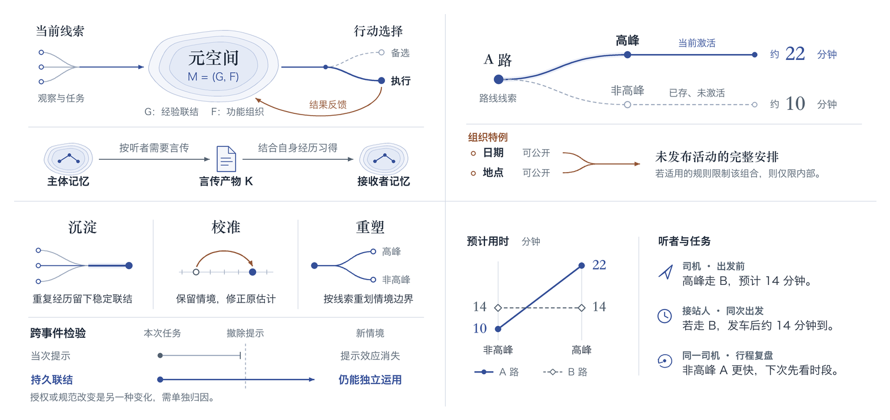

# Mnespace

**Generative memory that acts.** ／ 记忆，生成行为。

[](https://creativecommons.org/licenses/by/4.0/)

> **Mnespace** = *mneme* (memory) + *space*. The name renders the theory's core construct **元空间 (meta-space)** as what it actually is: a space of memory, not an abstract "meta". This repository is the open-source release of the paper **《生成性记忆理论：元空间中的记忆建构与智能行为生成》** (*Generative Memory Theory: How Agents Construct Memory in Meta-Space to Generate Intelligent Behavior*).

---

## What is this?

Most agent systems treat **knowledge** — documents, ontologies, retrieved facts — as the thing that guides action. **Generative Memory Theory (GMT)** inverts this: the substance guiding intelligent behavior is **generative memory**, an associative structure the agent continually **constructs** through interaction with the digital and physical worlds. **Meta-space (元空间)** is the functional setting where this construction happens and where memory is organized to guide perception, imagination, and action.

The paper is a **theory with falsifiable hypotheses**, not a finished system. It offers a functional model, eight research propositions with matched-control experiments, a reference architecture, and an evaluation design.

## Core ideas

- **Generative memory, not a store.** Behavior arises from memory; knowledge is the *articulated export* of memory, not its runtime substance. Reading a manual once does not create the structure that handles exceptions.
- **Meta-space `M = (G, F)`.** `G` is an associative network of cue–action–consequence links that persist across events; `F = (S, A, T, V, κ; N)` organizes how those links are used for situation discrimination, prospective simulation, valuation, self-competence, and role.
- **Activation → selection → expression.** `Act(G, c)` evokes a judgment basis; `Gate(P_int, r, c)` selects what is worth saying to a listener in a scene; `Read(P_out)` forms the utterance or action.
- **Construction dynamics.** Feedback drives **sedimentation (沉淀)**, **calibration (校准)**, and **restructuring (重塑)** — distinguished from transient prompt effects and institutional authorization changes.
- **Contextual articulation (情境化言传).** The same memory yields different content for different listeners/scenes because *communicative need* differs — not because of secrecy. Formal disclosure rules constrain expression only where applicable; composition can make a set sensitive even when each item is public (the mosaic effect).
- **Acquisition (习得).** A recipient rebuilds capability through demonstration, practice, and feedback; the criterion is delayed retention and unprompted transfer, not repeating an explanation.
- **Eight propositions (P1–P8)** with causal-intervention tests (e.g., connection swapping, cross-task directed transfer, paired yoked-review controls).

## Figures



| # | Figure | Topic |
| --- | --- | --- |
| 1 | [元空间机制](论文配图/01_元空间机制.png) | Action–feedback loop and cross-agent articulation/acquisition |
| 2 | [联想激活与组合敏感性](论文配图/02_联想激活与组合敏感性.png) | Associative activation and compositional disclosure |
| 3 | [建构动力学](论文配图/03_建构动力学.png) | Sedimentation, calibration, restructuring |
| 4 | [情境化言传](论文配图/04_情境化言传.png) | One trip memory, three communicative tasks |

Vector sources (`.svg`) and the figure generator (`render.py`) are in [`论文配图/`](论文配图/).

## Repository contents

```
.
├── 生成性记忆理论论文.md      # paper source (Markdown, Chinese)
├── 生成性记忆理论论文.docx    # paper (Word, with figures & superscript citations)
├── 论文配图/                  # figures (PNG + SVG) and render.py
├── README.md
├── CITATION.cff
└── LICENSE                    # CC BY 4.0
```

The Markdown source uses inline citations rendered as superscripts (GB/T 7714 numeric style) in the Word file; 77 authoritative references are listed and cross-checked.

## Status & scope

- This is a **functional theory of intelligent behavior**, not a claim about phenomenal consciousness.
- The AGI claim is a **necessity hypothesis** (generative memory is necessary for intelligent behavior), explicitly *not* a sufficiency claim. Section 9.4 states its falsification condition.
- The reference architecture (GMT-LLM) is **proposed**, not implemented here. Code may follow in future releases.

## Citation

If you use this work, please cite it (see [`CITATION.cff`](CITATION.cff)):

```bibtex
@misc{wang2026generative,
  title  = {Generative Memory Theory: How Agents Construct Memory in Meta-Space to Generate Intelligent Behavior},
  author = {Wang, Yang},
  year   = {2026},
  url    = {https://github.com/mnespace/mnespace},
  note   = {Open-source theory paper, CC BY 4.0}
}
```

## License

The paper text and figures are licensed under **[CC BY 4.0](LICENSE)** — you may share and adapt with attribution. Any future code will be licensed separately (likely MIT).

---

## 中文简介

**Mnespace**（mneme 记忆 + space 空间）是论文《生成性记忆理论：元空间中的记忆建构与智能行为生成》的开源仓库。理论主张：指导智能行为的实体不是知识存储，而是智能体在与数字世界和物理世界交互中主动建构的**生成性记忆**；**元空间**是这一建构发生、记忆被组织以指导感知、想象与行动的功能场域。核心机制包括 `M=(G,F)` 的功能结构、`Act→Gate→Read` 的激活与表达选择、沉淀/校准/重塑的建构动力学、**情境化言传**（同一记忆因沟通需要而非密级对不同听者呈现不同内容）与**习得**（以延迟保持和无提示迁移为判据）。论文给出八条可证伪命题及对照实验设计。本仓库发布论文（Markdown/Word）与配图，许可证 CC BY 4.0。
