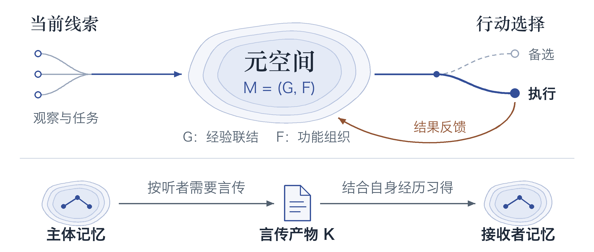
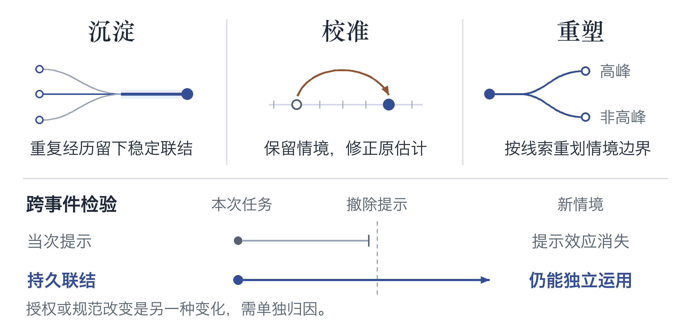

# 生成性记忆理论：元空间中的记忆建构与智能行为生成

**摘要：** 智能体何以在没有现成答案的情境中辨认局面、预期后果并作出选择？生成性记忆理论（Generative Memory Theory，GMT）将**元空间**界定为智能体持续建构自身能力的功能场域。智能体在其中把来自数字世界与物理世界的经验组织成能够指导感知、想象与行动的结构，即**生成性记忆**。已有记忆参与当下判断，行动反馈又成为修正记忆的依据。记忆也参与决定智能体向人说什么：即使事实和权限相同，听者已有的认识、要作的判断和当前交流目的不同，主体也会从同一记忆中选择不同的事实、理由或建议，本文称之为**情境化言传**。正式的保密规则只在适用时限定表达范围。**习得**则是接收者借助已有能力、示范或实践，形成可保持、可迁移的判断；能够复述一次说明不等于已经获得相应能力。GMT 的通用智能假说是：生成性记忆是智能行为的必要基底。为检验这一假说，本文给出功能模型、八条研究命题、参考架构与评估设计。

**关键词：** 生成性记忆；元空间；记忆建构；情境化言传；前瞻模拟；习得；通用智能

**Title:** Generative Memory Theory: How Agents Construct Memory in Meta-Space to Generate Intelligent Behavior

**Abstract:** How does an agent recognize a situation, anticipate its consequences, and choose an action when no ready-made answer is available? Generative Memory Theory (GMT) defines **meta-space** as the functional setting in which an agent continually develops its capabilities. Within this setting, the agent organizes experience from digital and physical environments into structures that guide perception, imagination, and action. We call these structures **generative memory**. Existing memory informs present judgment; feedback from action can, in turn, revise that memory. Memory also shapes what an agent says. Even when facts and permissions are held constant, what the listener already knows, the decision they face, and the purpose of the conversation can lead the agent to select different facts, reasons, or recommendations from the same memory. We call this **contextual articulation**. Formal disclosure rules constrain that selection where applicable. In **acquisition**, a recipient draws on prior abilities, demonstrations, or practice to develop judgments that persist and transfer; repeating an explanation does not establish that the underlying capability has transferred. GMT advances the hypothesis that generative memory is necessary for intelligent behavior. We present a functional model, eight research propositions, a reference architecture, and an evaluation design for investigating this hypothesis about general intelligence.

**Keywords:** generative memory; meta-space; memory construction; contextual articulation; prospective simulation; acquisition; artificial general intelligence

## 1 引言

### 1.1 能取得知识，何以仍不会行动？

第一次走上一段湿滑的斜坡，人也可能在脚底轻微一滑时缩短步幅。以往经验没有储存“这条坡上下一步该迈多远”的答案，却可能改变人注意到的线索、预期的后果和愿意采取的动作。这里要解释的，不是怎样找回一个旧答案，而是过去怎样参与产生一个新选择。

对人工智能体，同一问题常被知识的可得性所掩盖。信念与意图架构组织行动理由 [26-27]，本体与规则刻画领域知识 [30,33]，检索增强生成（RAG）使模型能查用外部文档 [38]，工具学习把推理与环境操作联系起来 [36-37]。这些方法解决了不同问题。GMT 质疑的是从“系统取得了正确描述”到“系统已经具备相应胜任力”的推断：同一份手册交给新手和熟手，为什么两人都能照章办事，遇到手册未列的例外却作出不同判断？

### 1.2 “一切行为来自记忆”作为理论主张

GMT 的出发点是“人的一切行为都来自于记忆”。本文考察这句话关于**智能行为**的版本：主体根据目标和变化的情境，在多种可能行动之间作出选择时，既往经验留下的结构是必要基底。这不要求主体先有意识地回忆，也不意味着当下输入、身体或执行机构可以缺席。非随意反射不在本文的解释范围内；一项新任务是否需要记忆，应在界定任务之后检验，不能先以“依赖经验”作为纳入标准。

这一假说来自三类研究。重构性回忆与情景想象的研究表明，记忆成分可以重组，用来构造未经历的事件 [15,58-59]；预测加工提供了既往预期与当前感觉共同约束知觉的模型 [16-17]；技能研究则说明，熟练者能作出自己难以完整说明的判断 [1,3,6-7]。这些结果提示了共同基底的可能性，但其中任何一条都不能证明其必要性。

**记忆的判据独立于行为是否成功：** 一种结构因过去的经验而形成或改变，在原事件结束后仍保留，并能在当前输入与执行条件相同时，使后续的判别、预期或选择产生可辨认的差异。影响可以有益，也可以是持续的误判。预训练或观察示范可以留下这样的结构；当前刺激、外部授予的权限和原初执行接口，不因影响行为便自动算作主体的记忆。

### 1.3 智能体在元空间中主动建构什么？

建构的主体是智能体，直接对象是能够指导判断与行动的记忆结构，元空间是这一过程发生并持续展开的场域。“建构”沿用建构主义的基本含义 [44,77]：主体以已有经验解释当前遭遇，比较预期与结果，保留、修正或重组原有联结。由此形成的**生成性记忆**既是此前建构的结果，也是下一次判断和建构的起点。

以湿滑斜坡为例：当下缩短步幅可能只是对脚底打滑的即时调整；若此后走上另一段斜坡，人在尚未打滑时已能从触感中辨认风险、预先调整步幅，才有证据表明此前的反馈改变了可复用的判断能力。元空间中的建构，关心的正是从前一种变化到后一种变化的过程。

### 1.4 研究问题与贡献

**RQ1（结构）：** 同一套经验如何组织情境判别、转移预期、行动选择和对自身把握的估计？**RQ2（机制）：** 同一记忆如何生成行动，又如何因听者和场景而被表达为不同内容？行动与交流的反馈怎样参与主体的下一次建构？**RQ3（检验）：** 哪些可观察的结果能区分共享记忆结构、检索到的知识以及为各任务分别训练的机制？

本文的贡献有三：以联想网络及其六项功能描述经验如何组织为元空间；提出**情境化言传**，解释同一主体为何向不同的人、或向同一人在不同场景中，选择不同的事实、理由和行动建议，并以习得解释接收者如何重建能力；提出八条研究命题及其对照实验。正式的保密规则只在适用的场景中限定表达范围，不是言传随情境变化的前提。

本文讨论智能行为的功能机制，不处理现象意识。关于通用智能（AGI）的主张是必要性假说，不是仅凭记忆即可实现通用智能的充分性命题（9.4 节）。

## 2 理论基础

下列研究分别约束理论的不同部分：记忆研究说明经验可以怎样保留和重组，认知架构提供可比较的行动机制，社会认知与信息流研究则解释表达面向谁、受什么约束。

### 2.1 哲学：知道如何、隐性之维、工具透明与记忆即行动

Ryle 区分“知道如何做”与“知道某事为真”[1]；Stanley 与 Williamson 对这种区分的解释提出异议 [2]（见 9.2 节）。Polanyi 的隐性知识 [3]、海德格尔的上手状态 [4] 和梅洛-庞蒂的身体图式 [5] 从不同角度说明，胜任可以表现为行动准备，而不必先表现为口头说明。Bergson 对习惯记忆的分析则提出了本文关心的问题：过去如何通过已形成的动作倾向进入当下 [57]？

### 2.2 记忆科学：重构性记忆与前瞻脑

Bartlett 的重构性回忆 [15]、Tulving 的情景记忆 [60] 和 Squire 对记忆系统的区分 [61] 表明，保留经验并非单一的复制过程。对回忆与想象的研究 [58-59] 以及心理时间旅行研究 [67] 进一步提示：同一段经验的成分可以被重新组合，用于描述可能的未来。

### 2.3 分布式联想记忆与情境提取

并行分布式加工、Hopfield 联想记忆和 Anderson 的交互记忆模型说明，部分线索可以经联结唤起更完整的模式 [71-72,76]。认知地图及位置细胞、网格细胞研究为“经验具有可导航的组织”提供空间领域的参照 [13,74-75]，不要求抽象经验也编码为物理网格。编码特异性说明提取取决于当前线索与编码条件的关系 [73]；它解释何种内容容易被想起，不能单独决定何种内容获准说出。

### 2.4 记忆动力学：巩固、再巩固与预测地图

互补学习系统（CLS）区分快速编码个别事件与较慢抽取跨事件结构 [62]。再巩固研究发现，在特定条件下，已激活的记忆需要重新稳定 [63]；这为提取后的更新提供参照，并不意味着每次提取都会改写记忆。海马预测地图 [64]、预测加工 [16-17]、世界模型 [18-19] 与 Dyna 等规划架构 [20-21] 分别提供了从经验形成预期、利用预期评估行动的模型。

### 2.5 技能、惯习与认知架构

Dreyfus 的技能习得 [6-7]、James 的习惯论 [8] 与双过程研究 [11] 都关注审慎选择如何转为熟练行动。Newell 的统一认知架构 [43]、ACT-R 的程序化 [9] 和 Soar 的组块机制 [10] 已能解释经验如何改变后续行动。Lewin 的场论 [46]、Bourdieu 的惯习 [47] 为行动倾向的社会形成提供参照。CoALA [39]、Voyager [40] 和生成式智能体 [41] 则展示了语言智能体组织、积累和调用经验的不同方式；与 GMT 的可检验差别见 9.1 节。

### 2.6 自我、社会与集体记忆

自我记忆系统与自传体记忆研究 [65,70] 说明，个人经历与持续目标会影响对事件的组织；本文据此讨论角色核心 N 的经验成分。集体记忆、组织记忆和分布式认知 [25,68-69] 说明知识可以跨主体和载体保存。制度授予谁何种权限，是在这些描述之外另需指定的规范。Nelson 与 Narens 的元记忆框架 [66] 则启发了对自身胜任度的估计 κ。

### 2.7 情境行动、可供性与对照

可供性 [22]、情境行动 [23] 和反应式架构 [24] 提醒我们，当下环境可以直接约束动作；不能把环境提供的信息事后全算成记忆。信念—愿望—意图架构 [26-27]、智能体理论 [28-29]、本体工程 [30-33] 和 RAG [38] 则提供另一面：显性描述确实能参与决策。GMT 所问的是，给定同样的环境和描述，主体自身保留下来的哪部分结构还会改变行动。

## 3 元空间：记忆建构的场域及其结构

### 3.1 核心概念：元空间的功能定位与结构描述

**元空间是智能体持续建构生成性记忆、形成和发展行动能力的功能场域。** 数字世界与物理世界提供交互对象及反馈；元空间描述主体如何把这些经历联系起来，在行动前预演可能的后果，在行动后依据反馈修正联结。这里的“场域”按功能界定，而不指某一个训练环境：任务可以结束，已形成的联结仍可进入下一次判断。

在给定时刻，元空间的组织状态记为 M = (G, F)。G 描述哪些线索、动作和后果相联，F 描述这些联结怎样用于判别、预期和选择。“元”指多种具体判断可由同一组关系生成；“空间”指模式之间有邻近关系、可达路径和行动边界。建构改变这些关系，因而元空间自身的组织也随经验演化。图 1 区分个体的行动与反馈循环，以及不同主体之间的言传与习得。

*图 1　元空间中的行动反馈与跨主体习得*

本文区分**运行格式**与**言传格式**，区分的是同一内容怎样起作用，而不是把“知识”限定为纸面文字。一条规则可以写在手册里，可以被接收者理解，也可以经已有解释器直接约束行动。前者使内容可共享，后两者取决于接收者已有的运行结构。由一次正确执行，不能反推出接收者已形成能处理例外的新结构；反之，一项技能也不一定能由有限的文字完整传给别人。

### 3.2 联想基底、情境激活与表达选择

**定义 1（联想记忆网络）。** 设 G = (U, W)，U 是表征线索、事件特征、动作或结果的元素集合，W 中的 wᵢⱼ 表示元素间联结。一个事件可以分布在多个元素及其联结上；同一元素也可以参与多个事件。当前激活是暂态，经验留下的元素和联结变化可以跨事件保留。部分线索能唤起相关模式，强而稳定的路径可支持习惯行动。这一描述借鉴分布式表征与联想记忆 [71-72,76]，不限定某种神经网络算法。图 2 以路线和时段说明部分线索怎样唤起联想模式；下半图另示组织场景中的组合规则（5.7 节）。

*图 2　联想模式的激活与信息组合的披露边界*

**定义 2（言传的受众与场景）。** 受众 r 表示这次交流面向的人，尤其是对方已经知道什么、与主体有哪些共同经历、接下来要作什么判断。场景 c 包括当前事件、交流目的、任务阶段及已经说过的内容。角色可以是线索，却不能替代对具体听者的了解；同一个人在赶路时和在复盘时，所需的信息也不同。主体对听者所知的估计可以被追问或反馈纠正 [51-53]。

**定义 3（情境激活与表达选择）。** `P_int = Act(G, c)` 表示主体按当前线索和任务唤起的判断依据 [73]。`P_out = Gate(P_int, r, c)` 表示从这些依据支持的内容中，选择本次值得向 r 表达的部分：哪些结论直接回答对方的问题，哪些理由有助于对方判断，省略哪项条件会导致误解。`Read(P_out)` 再将所选内容组织成话语。门控首先决定**说什么**，措辞决定**怎么说**。事实依据不变时，可以改变重点和详略，不应改变事实、证据的强弱或结论的适用条件。

如果两位听者所知和所需都相同，适切的输出也可以相同。理论预测的是内容随**沟通需要**而变，而不是只因换了姓名或身份就换一套说法。存在正式授权时，哪些依据可用于判断、其中哪些结论可告知受众，还须满足相应的披露边界（5.7 节）。

### 3.3 功能组织的形式化定义

F 描述主体如何借助 G 使用既有的感知、执行和规范接口。列入功能模型，不等于宣称接口本身也是经验的产物。下文以 a 表示行动（a ∈ A），r 表示受众，c 表示场景。

**定义 4（情境空间）。** δ: E → S 将主体可观察的环境线索 E 映射到情境 S。划分的依据是：在当前任务精度下，这些线索是否支持对候选动作及其后果作相近的预期。两种局面即使眼下都要暂停办理，若补正途径和后果不同，仍可属于不同情境。经验可使这种判别变细 [6-7]。

**定义 5（行动库）。** A = A₀ ∪ A_T，分别表示原初动作与工具介导的动作。能够调用某个动作是起点；能辨认何时调用、怎样组合、何时应当停止，才是经验可改变的程序性组织。

**定义 6（转移预期与前瞻模拟）。** 设 O 为可观察结果的集合，Δ 表示概率分布的集合。T: S × A → Δ(S × O) 给出在情境 s 执行动作 a 后，下一情境与结果的联合预测分布。沿 T 展开可在行动前预演，在行动后辨认偏差 [58-59,64]。这里称“前瞻模拟”；它不同于记得在将来执行某项意图的“前瞻记忆”。

**定义 7（价值函数）。** V: S × A × S → ℝ ∪ {⊥}。若候选转移违反硬约束，V 取 ⊥ 并排除该候选；对其余候选，再按目标、软规范和角色承诺赋值比较。经验可以改变对后果的评价；明文禁令则可由有权者直接设定，不能用更高的目标收益抵消。

**定义 8（自我胜任度）。** κ: S × A → [0,1] 估计“主体在 s 中执行 a 能达到验收标准”的概率。它可以失准，需要用实际成败校准。T 回答“可能发生什么”，κ 回答“以我的能力有几分把握达标”；后者借鉴了元记忆的监测功能 [66]。

**定义 9（角色核心）。** N 表示主体较稳定的承诺及评价依据，影响哪些结果值得追求、什么算完成。在组织域，写作 N = ⟨Resp, Acct, Crit, Disc⟩，即责任、问责对象、验收判据和披露义务。主体可以从履职经历中形成稳定判断，这与自我记忆研究有关 [65,70]；岗位授权本身来自制度，不能由自传体经验推出。在没有组织角色的任务中，无须假设存在问责链或正式密级。

**定义 10（元空间的结构表示）。** 以 M = (G, F) 表示元空间在给定时刻的组织状态，其中 F = ⟨S, A, T, V, κ; N⟩。给定当下输入与任务，主体依据已有联结形成判断、选择并执行行动（第 4 节）；执行结果随后可改变这些联结及其功能组织（第 5 节）。G 与 F 分别刻画该场域的联结结构和功能组织。

一个最小实例可说明这种关系。将办理中观察到的“情境—操作—后果”作为加权联结；在同一情境、同一操作下，将通向各后果的出现次数归一化，就得到一个经验转移分布 T。再按 Crit 标注这些后果是否达标，就能从同一批经历估计 κ。若验收标准改变，即使对后果的预测完全相同，对达标的把握也可改变。这是 G 实现两种功能的一种方式，并不预设大脑或所有智能体都按频数计数。

### 3.4 六项功能及其认知参照

| 元空间构件 | 认知参照 | 功能 | 相关研究 |
| --- | --- | --- | --- |
| S 情境空间 | 语义/知觉记忆 | 把经验组织为可判别的情境 | Tulving [60]、Squire [61]、Bartlett [15] |
| A 行动库 | 程序性记忆 | 技能与习惯，含工具介导行动 | Squire [61]、ACT-R [9]、Soar [10] |
| T 转移预期 | 情景想象、前瞻模拟 | 用既往经验预演未发生的后果 | Schacter 等 [58-59]、预测地图 [64]、心理时间旅行 [67] |
| V 价值函数 | 价值学习与情感经验 | 评价可行行动的后果 | Damasio [70]、强化学习 [20] |
| κ 自我胜任度 | 元记忆的监测功能 | 估计自己能否达标 | Nelson 与 Narens [66] |
| N 角色核心 | 自传体记忆与持续目标 | 维持评价依据；在组织中落实责任与义务 | Conway 等 [65]、Damasio [70] |

表中对应的是功能问题，不是六个独立脑区，也不是对六类生物记忆的重新分类。GMT 较强的承诺是**结构共享**：如果两项功能确实依赖同一条习得联结，在一项任务中纠正它，应在另一项尚未重新训练的任务中留下方向可预测的变化（P8）。操作上，“同一条习得关系”可用**干预等价**界定：对某联结施加同一干预，若两个读出任务出现方向一致的预测变化，则判二者共享该关系；共享程度由定向迁移幅度与无关线索的稳定性共同度量（H8）。

### 3.5 习惯路径与行动边界

“地形”描述候选路径之间的差异：反复使用的联结可形成**习惯路径** [8-10,42]，V 区分较可取的路径和硬约束排除的**禁区**，κ 区分把握高低。某类任务若已有稳定路径、后果预测可靠且把握经得起检验，就属于**熟练区**；熟练区占目标任务分布的比例可用来描述成熟度。其中，习惯可由重复经验形成，制度划定的禁区则未必是学习涌现的结果。

### 3.6 知识与本体的重新定位

规则、标准作业流程（SOP）、文档和本体可以作为言传产物保存与流通 [30,32]；技能库还可以包含能由既有执行器直接运行的程序 [39-40]。RAG 把外部描述带入当前任务 [38]，完全可能改善这一次决策。检索是否也带来持久习得，应在撤除文档、改变例外条件后另行测量（5.6 节）。

## 4 空间导航：记忆如何生成行为

### 4.1 从情境激活到行动选择

一次导航可分六步：**定位**，以 δ 从当前线索识别局面；**定向**，依据任务与 N 确定目标 [26]；**预演或调用习惯**，必要时沿 T 比较候选后果 [12,14]；**选择并行动**，排除 V 中的禁区，结合价值和 κ 选取足够好的路径 [45]；**核对**，将实际结果与预期比较并及时调整 [23]；**验收与记录**，依据判据保留可供后续学习的轨迹。激活提供候选和依据，执行才在环境中产生行为。若行动是向人解释，还须按定义 3 选择此人此刻需要的内容。

### 4.2 双模态与元记忆

在熟练区，主体可沿已有路径直接行动，减少显式预演，称为**直觉模式** [6-7,9,11]。若情境新异或 κ 较低，且进一步比较有助于判断，主体可沿 T 展开候选后果，进入**推演模式**。切换是否有益取决于 κ 的校准 [66]：高估自己会过早行动，低估自己则会在熟悉任务上反复推演。

### 4.3 工具透明化

工具介导行动可由显式核对接口转为熟练调用，工具本身不再占据注意中心 [4-5]。可用的接口数量说明主体能尝试哪些动作；在相同任务成功率下，调用前的推理成本是否随经验下降，则说明已有工具是否真正变得上手。两者是不同维度。

### 4.4 规范作为地形

对已正确表示并能识别的硬约束，规划时排除取值为 ⊥ 的候选；仅在剩余候选中权衡目标和软规范。若后果预测有误或规范没有被表示，形式上的禁区并不保证执行必然合规。组织域可依据 N 中的问责关系追溯约束的来源。

### 4.5 边界行为：何时求助

当 κ 较低、试错代价高且有可用的帮助时，求助可以优于自行尝试；明确禁止的候选则应直接排除。是否求助同时依赖把握、代价和可用支持，而非由低置信度单独决定 [44,66]。

### 4.6 感知、想象与行动的共享基底假说

回到湿滑斜坡。**感知**中，过往经验可能让人从模糊触感中更早辨认出打滑，当前感觉仍能纠正预期 [16-17]；**想象**中，人可以在尚未迈步时组合坡度、步幅与失稳后果 [58-59,64,67]；**行动**中，同一预期和身体当下的把握共同影响下一步。三种任务的输入和读出不同。称其“同源”，不是说三种过程完全相同，而是说它们可以调用同一条习得关系。

由此产生一个比“都会受经验影响”更强的预测：若只在后果预测任务中纠正某种线索与打滑的关系，那么在不再反馈的模糊线索判别和路线选择中，也应出现与这次纠正一致的变化。若各任务只能分别练习才改变，便应削弱对该关系共享程度的判断。这是对通用基底假说的局部检验，而非从三种现象直接推出全称结论。

## 5 记忆动力学：建构与演化

### 5.1 建构总论

在时刻 t，主体依据元空间当时的组织状态 Mₜ 和场景 cₜ 选择行动，记作 aₜ = π(Mₜ, cₜ)。观察结果 oₜ 后，组织状态可更新为 Mₜ₊₁ = Learn(Mₜ, cₜ, aₜ, oₜ)。前式描述如何运用既有记忆，后式描述反馈如何参与建构。一次尝试可以是建构过程的一部分；是否形成了新的记忆结构，要看改变能否跨事件保留。下文先讨论个体内的沉淀、校准与重塑，再讨论跨主体的言传与习得。社会授权可改变允许的用途，但不能由学习成绩自行获得。图 3 对照三种建构过程，并区分当前提示、持久记忆与制度条件的变化。

*图 3　沉淀、校准与重塑：反馈驱动的三类记忆更新*

### 5.2 沉淀（编码与巩固）

沉淀指多次经历中可重用的关系被保留下来。成功轨迹可形成习惯路径，反复失败也可使主体识别不该沿用某动作的线索。CLS 的快编码与慢抽取 [62]、习惯形成 [8]、程序化和组块 [9-10] 为此提供不同层次的解释。单次成功能否算作已经习得，需要看延迟后是否保留、换一个局面是否仍然有效。

### 5.3 校准（再巩固与误差更新）

实际后果与预测不符时，可在原有情境划分内更新 T；验收结果与原有把握不符时，可校准 κ。两种误差不必相同：主体可能准确预见失败，并且正确地给出低把握。这里的校准是局部参数更新；误差驱动学习 [16-17] 和特定条件下的记忆再巩固 [63] 是其认知参照。

### 5.4 重塑（图式重构）

若同一情境内的误差持续按某线索分成两类，仅调整一个平均值就会反复出错。此时可拆分 S、改变 T 的联结或重估原有经验性偏好，形成图式重构 [15]。反之，若只是同类操作整体变慢，更新已有转移参数可能已经足够。区分两者的依据是误差的结构，而不是变化看起来有多大。

### 5.5 情境化言传：从同一记忆选择不同内容

**定义 11（情境化言传）。** 言传记为 χ(M, r, c) → K：主体从元空间 M 中，依据受众 r 和场景 c 选择、组织并表达与当前交流有关的记忆内容，形成可传输的产物 K。K 可以是一句提醒，也可以是解释、SOP 或技能代码。即使记忆、事实与访问权限相同，面对不同的听者，或面对同一个人但交流目的不同，主体也可能选择不同的依据、结论和下一步建议（P7）。这种读出具有重构性 [15,58]；有限的表达未必保留专家用来判断例外的全部线索 [1,3]（P2）。

言传使个体判断中可表达的部分能被共同保存、复核和修订，与知识创造研究中的“外化”相关 [34]。组织知识库可以保存这个产物；下次使用时，另一位成员仍须在新的任务和责任关系中解释它 [68-69]。

“言传”强调表达有对象、有取舍，并不限于口头语言；“习得”强调变化发生在接收者身上。前者的终点是可共享的产物，后者的判据是能否独立判断。两者并不互逆。

### 5.6 习得：即时执行、保持与迁移

**定义 12（习得）。** 在知识传递情境中，记 ρ(M, K, H) → M′：M 是接收者原有的元空间，K 是收到的言传产物，H 是此后与该任务相关的示范、操作及反馈历史。H 可以为空；没有教师或文档时，也可以只从经历中学习。是否发生习得，取决于撤除当次提示后能否保持改变，以及改变能否迁移到相关新情境，而不取决于是否采用某一种教学形式。

例如，今天下发新的审批额度，已有规则解释器可以立即使超额申请转复核。这验证了规则能生效。若同一申请的两份凭证金额不一致，主体是否知道应先核验，而不是任取一个数字套用上限？要检验这种判断，应另给没有范例提示的新案。经验丰富的接收者读一次也可能实现迁移。GMT 的进一步预测是：对于手册没有列明、须比较行动后果才可辨识的例外，带反馈的经历比同等时长的规则阅读更有帮助 [21,35,62]。亲自选择操作是否又比观看完全相同的操作与反馈更有帮助，由 H3 的配对对照检验。

### 5.7 对谁说什么：受众、场景与表达边界

设同一份公开行程记录显示：A 路非高峰约 10 分钟、高峰约 22 分钟，B 路两个时段均约 14 分钟。司机与接站人都可以查看整份记录。即便三次请求的字面都是“说说这趟行程吧”，听者要解决的问题仍可能不同：

| 听者与场景 | 本次需要解决的问题 | 从同一记忆中选择的内容 |
| --- | --- | --- |
| 司机，高峰出发前 | 现在选哪条路？ | “现在走 B，预计 14 分钟；A 在高峰通常更慢。” |
| 接站人，同一次出发前 | 什么时候去接人？ | “如果按建议走 B，从发车算起约 14 分钟到，按这个时间安排接站。” |
| 同一位司机，行程复盘时 | 下次是否也该选 B？ | “不一定。A 在非高峰约 10 分钟，比 B 快；高峰时情况相反。下次先看出发时段。” |

前两行固定场景、改变受众：路线比较帮助司机选择，到达时间帮助接站人安排。第一行与第三行固定受众、改变场景：出发前需要当前结论，复盘时需要结论成立的条件。谁都没有被禁止看到哪条信息。若司机追问“为什么”，主体可沿已有联结补充两条路线的比较；若接站人说明自己其实在安排下一班车，也应据此修正对其需要的判断。这样的反馈可以帮助主体学会何时给结论、何时给依据，而不必给每个人存一套固定话术 [51-53]。图 4 对照了同一份行程记忆在这三种沟通任务中的表达。

*图 4　情境化言传：同一行程记忆在三种沟通任务中的表达*

**组织中的保密特例。** 在有正式授权的场景中，“此刻说什么有用”还受“哪些内容可以说、哪些必须告知”约束 [48,50,54]。例如，审批员获准使用内部额度判断是否转复核，申请人可获知办理状态和下一步，但未必可获知额度。只答“无可奉告”虽没有透露额度，也没有履行告知义务。受众需要、主体的使用许可与对外发布许可应分别表示。

在这个特例中，可以给元素附上密级 λᵢ [49]。对拟表达的组合 Q，整体密级为 λ(Q, c) = L(Q) ∨ μ(Q, c)：L(Q) 是各项密级的最小共同上界，μ 是场景 c 下适用的组合规则给出的附加等级，∨ 取两者的最小共同上界。未触发组合规则时，μ 取最低级。选出的组合须在受众许可内，并符合具体用途；多轮交流还需考虑此前已告知的内容。接收者应保留适用的来源和传播约束 [55]，并另行判断来源是否可信 [56]。

上述约束划定可表达的范围，却不能从范围之内挑出最有用的内容。对情境化言传的首要检验，是听者能否据此作出眼前的判断；有披露义务时，再检验是否过度披露或遗漏应告知的内容。

### 5.8 记忆的生命周期

对给定任务，可以区分**形成**（开始辨认稳定关系）与**成熟**（熟练路径已覆盖大部分常见情境）。环境改动可能带来**漂移**，表现为曾经可靠的预期持续偏离实际。若原情境划分仍然有效，校准即可恢复；只有原划分反复混淆不同局面时，才需要**重塑**。同一主体对一个任务已经熟练，对另一个任务仍可处于形成期。

## 6 理论命题

下列 P1–P8 是理论命题，H1–H8 是其在指定任务中的可观察预测。二者的范围不同：工程对照检验某机制能否解释该任务中的差异。某个实现的胜负不能直接裁决关于一切智能行为的主张；什么样的结果构成必要性假说的反例，见 9.4 节。

**P1（经验结构的因果作用）。** 即使当前输入和可查知识完全相同，过去形成的特定联结仍能改变判断。**H1：** 让同构智能体经历两种不同的“线索—后果”关系。在首次无反馈测试中，只对调相关记忆联结，预期和选择应向对方的经验所预测的方向移动；对调无关联结不应造成同样的定向变化。这比“完整系统优于纯检索”更能定位差异来源。

**P2（言传的条件性损失）。** 在受众、用途和表达预算固定时，言传可能保留结论却遗漏用于辨别例外的线索 [3,15,58]。**H2：** 与接收专家相关运行结构的同构接收者相比，仅接收专家说明者在未见例外上的成功率较低；在规则已经明列且没有例外时，差距应缩小。直接复制是任务内的参照，不是所有学习方式的理论上界。

**P3（习得中的反馈与主动选择）。** 对必须辨别例外条件的任务，知道规则、见过后果和亲自选择行动可能带来不同程度的迁移 [21,35,62]。**H3：** 在给定同一份手册后，接触带反馈案例的接收者比只读手册者更能处理未见例外；更强的预测是，当试探动作的选择对判别例外重要时，主动演练者又优于回看其完整轨迹与反馈的配对者。前一差异不能替代后一差异。

**P4（模态切换与自我胜任度）。** 在熟练与新异情境混合的任务中，校准良好的 κ 可用于分配推演成本 [9-11,66]。**H4：** 在预先规定的成功率容差内，按 κ 切换的主体比全程推演者单位成功成本更低；在保持切换频率相近但打乱 κ 与情境对应关系后，这一优势应减小。

**P5（工具透明化）。** 对同一组可用工具，反复成功的使用经验能减少熟悉操作所需的显式核对 [4-5,22]。**H5：** 固定接口、难度与验收标准时，熟悉操作的推理开销随有效练习下降；若确实形成了适用条件的判别，在另行留出的同类任务上，无效调用率也应降低。

**P6（角色核心与行为一致性）。** 在多个合规行动之间，稳定的责任承诺应系统地影响价值排序 [47,65,70]。**H6：** 固定任务经验、权限与可行选项，仅改变 N 中的职责优先级，在事先保留的价值冲突案例上，选择分布应沿独立评审预判的方向移动；职责不相关的对照案例不应出现同等变化。

**P7（言传的受众与场景依赖性）。** 同一记忆可以支持多种恰当的表达；选择哪些内容，取决于听者已有的认识和本次交流要解决的问题 [51-53]。**H7：** 固定事实、权限、提问措辞与答复篇幅，若改变听者或场景会改变所需信息，允许按二者选择内容的主体，应比只给同一份内容改换语气的主体更能交付关键依据、帮助听者完成下一步任务。不同版本仍须与同一份事实记录相符。单纯换称谓、增加字数，或在没有需要时刻意制造差异，都不算支持该预测。

**P8（生成性记忆的跨任务共享）。** 对同一条经验关系的修正，可以同时改变当前线索的解释、未来后果的想象和行动的选择 [16-17,58-59,64,67]。**H8：** 仅在其中一类任务中给予纠正反馈，在另外两类任务的首轮无反馈测试中，共享相关联结的主体应比各任务分别保存该关系的匹配主体表现出更大的定向迁移；无关线索上的表现应保持稳定。

H1 与 H8 检验记忆的因果作用和共享范围；H2、H3 与 H7 分别检验有限表达保留了什么、接收者学会了什么、表达内容是否随沟通需要而变；H4–H6 检验具体功能构件。若不同版本只是读起来不同，却没有让听者更好地理解或行动，就没有得到 H7 所预测的收益。

## 7 实现路径：GMT-LLM 参考架构

一种可检验的实现方案是以大语言模型（LLM）处理表达和候选生成，以向量与图表示保存联结，以环境反馈和离线回放更新这些联结。下表给出功能接口与可选做法，作为参考架构；它不预设已获得实验结果。

| 构件 | 功能 | 实现选项 |
| --- | --- | --- |
| G 联想记忆网络 | 保存跨事件联结 | 向量嵌入与带权图，或支持模式补全的联想记忆 [72]；区分持久联结与本次激活 |
| 组织披露规则（适用时） | 区分可用依据和可披露内容 | 元素标签、组合规则 μ、主体用途许可与受众发布规则 [48-50,54] |
| S 情境空间 | 局面判别 | 结构化情境模式 + LLM 判别 + 情境嵌入聚类；粒度随建构细化 |
| A 行动库 | 原初与工具介导行动 | 工具注册与函数调用；可供性描述；成本模型 |
| T 转移预期 | 前瞻模拟 | LLM 生成式模拟器 + 学习转移模型 + 沙箱；Dyna 预演 [21]；预测地图/后继表征 [64] |
| V 价值函数 | 目标、规范、角色权衡 | 价值章程编译为规划约束与评价；禁区=硬约束，梯度=软目标 |
| κ 自我胜任度 | 元记忆校准 | 不确定性估计 + 结果追踪在线校准 [66] |
| N 角色核心 | 维持承诺与验收依据 | 岗位章程与履职经历分开记录；角色可组织 V，但不能自行扩大授权 |
| 熟练区 | 直觉执行 | 保存可调用的技能和适用条件 [40]，验证后再复用 |
| χ 情境化言传 | 为同一事实选择不同的表达内容 | `Act(G, c)` 唤起依据；`Gate(P_int, r, c)` 结合对话已知内容和听者当前任务选择结论、理由或建议；`Read(P_out)` 形成说明 |
| ρ 习得 | 改变接收者的运行结构 | 规则阅读、示范回放或主动演练；用延迟保持和无提示迁移检验变化 |
| 巩固回路 | 沉淀与重塑 | 离线回放并抽取跨事件关系 [62]；据新证据更新原有联结 |

实现时应能分开追踪三种变化。**当前上下文改变**：检索到新规则后，本次行动可以立即不同。**持久结构改变**：回放或反馈更新了哪些联结，撤除原提示后能否复用。**制度条件改变**：某一审批权限或披露义务由谁、何时改变。若把三者都写入同一段不可区分的提示文本，就难以判断性能改善究竟来自学习、查阅还是授权变更。用 LLM 充当 T 时，还须以独立的实际后果核对模拟质量。

## 8 评估框架

### 8.1 度量

| 度量 | 定义 | 对应命题 |
| --- | --- | --- |
| 转移预测与定向变化 | T 与实际后果的吻合度；对调相关联结后，预测及选择向供体经验移动的幅度 | P1, P8 |
| κ 校准误差 | 在留出任务上，按置信度分组比较预计与实际达标率 | P4 |
| 导航效率 | 单位成功的执行成本 | P4, P5 |
| 空间覆盖度 | 任务分布落入熟练区或可预演区的比例 | P1 |
| 言传损失 | 同构接收者中，复制相关运行结构组与仅获说明组的成功率之差；分别报告明列规则与未见例外 | P2 |
| 即时执行、延迟保持与迁移 | 有提示当场成功率、撤除提示后原类任务成功率、撤除提示后未见例外成功率，分开报告 | P2, P3 |
| 透明化曲线 | 工具行动审慎成本随经验下降率 | P5 |
| 角色一致性 | 选择与独立评审预定的职责排序一致的比例；与职责不相关案例对照 | P6 |
| 关键内容覆盖率 / 听者任务完成率 | 按具体受众和场景预先标出完成任务所需的信息，分别测实际提供的比例，以及听者仅据该说明作出正确判断或行动的比例 | P7 |
| 事实一致性 | 对照共同的事实记录，检查不同版本是否给出无依据的断言、互相矛盾的判断，或把估计说成确定结果 | P7 |
| 组织披露指标 | 另计应告知信息的交付率、过度披露率，以及仅在信息组合后发生的泄密率 | P7 的组织特例 |
| 前瞻模拟精度 | 想象/规划情境的预测准确度 | P8 |
| 跨任务定向迁移 | 仅一类任务获反馈后，其余任务对相关线索的首轮判断沿预期方向变化的幅度，以无关线索和分立结构作对照 | P8 |
| 巩固增益 | 初次训练相同时，有无离线回放在延迟测验中的成绩差，另报回放成本 | P3 |

### 8.2 基准设计

基准至少包含两类环境：一类允许控制线索、行动与后果，便于识别经验的因果作用；另一类可以分别改变听者、沟通场景和披露条件，便于区分内容是否合用与内容是否获准表达。除被操纵的因素外，比较各组时固定基础模型、可用工具与测试条件。按情境而非仅按措辞划分训练和测试集，预先规定最小有意义差异、等效界值与推理预算，报告组间差异及不确定性。各组样本量应据预注册的最小有意义差异与预期方差作功效分析确定，报告置信区间而非仅点估计。

1. **联结干预（H1）。** 用两个除了特定线索所预示的后果不同之外均匹配的环境训练主体；测试时保留相同的文档、工具与规划器。分别对调相关联结、同规模的无关联结和不作对调，再恢复原联结作复核。主要指标是新情境中预测与行动是否按事先指定的方向改变，不是总体性能是否下降。
2. **言传—习得往返（H2、H3）。** 使用相同起点的接收者和同一份限长专家说明，设只读、配对回看、主动演练三组；另设复制专家相关运行结构的同构参照组。回看者逐步看到与配对演练者完全相同的观察、动作和反馈，匹配时长及更新预算，区别在于谁选择动作。分别测即时执行、延迟保持和未见例外迁移。若两组都优于只读且在预设界值内等效，可支持带反馈案例的作用，但不支持在这些条件下主动选择有额外收益。
3. **功能对照（H4–H6）。** 将按 κ 切换与全程推演、打乱 κ 后切换相比较；固定工具集合，比较不同练习量并在独立任务上测无效调用；在可行选项相同的价值冲突中替换职责排序，由不知道分组的评审独立判断。三项分别检验成本分配、工具熟练化和角色影响。
4. **环境漂移（H1、H3）。** 分别改变已有情境内的后果频率，以及引入必须据新线索拆分情境的例外。比较只允许参数校准与允许改变情境划分的模型，记录恢复速度及原有任务的保持率。把直接下发新规则后的即时合规与未见例外上的习得分开统计。
5. **受众 × 场景交叉对照（H7）。** 让两类听者分别经历即时决策和事后解释两种场景。四种组合使用同一份公开记录、相同权限和相同字面问题；事先独立标注各听者完成各任务所需的信息。在相同篇幅与生成预算下，比较按受众及场景选取内容、只给固定内容换语气，以及分别隐去受众或场景线索的版本。由未见生成条件的评审按信息项评分，再让听者仅据说明完成任务，同时检查事实一致性。另设只换姓名、保持所知与任务完全相同的对照：此时不预测实质内容应当改变。
6. **组织特例：组合规则与门控位置。** 在披露受限的任务中，设输出端逐元素检查、输出端组合检查、读出前组合门控三组。后两组取得相同的角色信息、单项标签与组合规则，可在相同预算内修改候选表达。先固定检查位置比较组合泄密率，再固定组合规则，在相同过度披露率上限下比较应告知信息的交付率。此对照检验制度边界的实现方式；它不能代替第 5 组无权限差异的情境化言传实验。
7. **跨任务迁移（H8）。** 在可控坡面环境中，以模糊线索判别、后果预测、路线选择作为三种独立读出。仅为后果预测提供纠正反馈，再冻结更新，测试另两项任务。比较关系共享与分立的模型；两组都可从同一经验记录学习，匹配初始能力、总容量和更新预算，均不提供判别或路线选择的训练答案。事先根据独立环境确定哪种变化算改判正确、哪条路线更合适，同时测无关线索。单纯改变一个模块使多项输出一起波动，不算成功迁移。

### 8.3 与现有基准的关系

网页操作、工具调用或代码任务都可以提供多步行动与验收结果。要用于 GMT 检验，还须能控制主体此前见过什么、测试时还能查到什么，以及一次纠正是否迁移到了没有单独训练的任务。仅知道最终完成率，不足以判别这些机制。

### 8.4 应用实例：组织审批与坡面导航

在审批任务中，S 区分业务局面，A 包括通过、补正或转复核，T 预测这些动作的后果，V 排除已识别的违规路径，N 给出岗位的责任与验收依据。主体结合 κ、试错代价与可用支持决定是否求助。制度变更能立即改写额度；带教的价值则体现在换一个例外后还能否判断。同一件转复核事项，交接时要说明谁来接手，复盘时要说明哪个条件触发复核；即便听者是同一位同事，两次所需的内容也不同。

在物理环境中，同样可以记录一次坡面滑动如何改变后续的线索判别、后果预测与速度选择。这时传感器和执行器是当下条件，跨试次保留的线索—后果联结才是待检验的记忆；不需要虚设一个岗位或密级。两个场景共享的是经验组织和更新的原则，而不是一套相同的业务构件。

## 9 讨论

### 9.1 与已有生成机制的差别在哪里？

ACT-R 与 Soar 已能让经验改变可执行规则 [9-10]，Dyna 已把学习、规划和行动纳入同一回路 [21]，语言智能体也会检索过去的经历来决定下一步 [39-41]。因此，“记忆能生成行为”并非 GMT 独有的预测。本文额外要求说明：同一条习得联结能否在不同读出之间传递一次纠正（H8）；在判断依据和权限不变时，按听者与场景选择记忆内容，是否比单纯调整措辞更能支持听者的任务（H7）。若已有架构在信息与预算匹配时给出相同结果，应将贡献定位为对共同机制的组织和解释，而非经验上的独占优势。

### 9.2 与理智主义的交锋

Stanley 与 Williamson 主张知道如何可以是命题知识的一种形式 [2]。一种知识能否作命题分析，与一份表述该命题的文本能否把能力交给别人，是不同问题。H2 和 H3 能检验有限言传及不同学习经历的后果，不能单凭读者实践不佳就裁决关于知识本性的争论。

### 9.3 隐性剩余

同一份说明可以对应不止一种判断结构。于是，对能力的评价需要同时看表达和行动：能否说清一般规则，能否在未见例外中正确判断，能否在没有把握时求助。若某个有界任务的规则已经足以无损转移能力，它给出 P2 的适用边界，而不是必须被解释掉的反例。

### 9.4 AGI 主张的边界

GMT 对 AGI 的主张是**必要而非充分**：要在开放、变化的情境中持续作出适应性选择，主体须能调用经验留下的结构；当下感知、目标和执行能力仍是条件。局部任务中发现结构共享，不能证明任何智能都必须如此。反过来，若一个主体在预先界定的开放任务上无需任何可归属于该主体的经验痕迹，仍能稳定完成新情境中的适应性选择，就构成对必要性主张的反证。检验前须划清主体与环境：既不能把有预训练的模型当作无经验主体，也不能在事后把设计者的经历改称为被测主体的记忆。

### 9.5 安全与问责

结构中的禁区和披露规则能使一项决策的约束来源可追溯，但制度遗漏、错误预测和实际措辞偏离所选内容，都可能使执行结果与模型不符。组织场景的审计因而需要分别记录主体获准使用了哪些依据、作出什么决定、受众实际收到了什么；记录本身也受相应权限约束。

### 9.6 局限

本文给出的是理论和评估设计，八条命题尚待系统实验。首要困难是能否在高维网络中独立定位并干预一条习得关系，而不同时破坏大批无关能力；否则局部干预很难解释。其次，模拟器的误差可能被误认为记忆误差，故需独立的环境反馈。组织场景另有两个限制：组合规则难以穷尽，受众“应当获知什么”也需要独立判定。即使工程实验支持所提机制，从人工系统的功能共享推广到人类认知仍需独立证据。

## 10 结论

生成性记忆理论提出：**过去之所以能指导一件从未发生过的事，是因为经验留下的不只是旧答案，还有辨认局面、预期后果和选择行动的结构。** 智能体在元空间中持续建构这样的记忆：已有记忆指导当下选择，实际后果则使主体有机会修正下一次选择的依据。情境化言传把其中一部分变成对具体听者有用的知识：有人需要当下的结论，有人需要形成结论的理由，同一个人换了任务也可能需要另一部分。习得的判据则在接收者一侧：离开当次提示后，他能否独立判断？

“人的一切行为都来自于记忆”在这里获得的是一个可追问的机制假说，而不是一句由定义保证为真的结论。它最直接的检验是：在改变一段经验留下的特定联结之后，面对同一个新局面，主体会看到什么不同、预期什么不同，又会作出什么不同的选择？

## 参考文献

[1] Ryle G. The Concept of Mind[M]. London: Hutchinson, 1949.

[2] Stanley J, Williamson T. Knowing how[J]. The Journal of Philosophy, 2001, 98(8): 411-444.

[3] Polanyi M. The Tacit Dimension[M]. London: Routledge & Kegan Paul, 1966.

[4] Heidegger M. Being and Time[M]. Trans. Macquarrie J, Robinson E. New York: Harper & Row, 1962.

[5] Merleau-Ponty M. Phenomenology of Perception[M]. Trans. Smith C. London: Routledge & Kegan Paul, 1962.

[6] Dreyfus H L, Dreyfus S E. A Five-Stage Model of the Mental Activities Involved in Directed Skill Acquisition[R]. Berkeley: Operations Research Center, University of California, 1980.

[7] Dreyfus H L, Dreyfus S E. Mind over Machine: The Power of Human Intuition and Expertise in the Era of the Computer[M]. New York: Free Press, 1986.

[8] James W. The Principles of Psychology[M]. New York: Henry Holt, 1890.

[9] Anderson J R, Bothell D, Byrne M D, et al. An integrated theory of the mind[J]. Psychological Review, 2004, 111(4): 1036-1060.

[10] Laird J E. The Soar Cognitive Architecture[M]. Cambridge, MA: MIT Press, 2012.

[11] Kahneman D. Thinking, Fast and Slow[M]. New York: Farrar, Straus and Giroux, 2011.

[12] Craik K J W. The Nature of Explanation[M]. Cambridge: Cambridge University Press, 1943.

[13] Tolman E C. Cognitive maps in rats and men[J]. Psychological Review, 1948, 55(4): 189-208.

[14] Johnson-Laird P N. Mental Models: Towards a Cognitive Science of Language, Inference, and Consciousness[M]. Cambridge, MA: Harvard University Press, 1983.

[15] Bartlett F C. Remembering: A Study in Experimental and Social Psychology[M]. Cambridge: Cambridge University Press, 1932.

[16] Friston K. The free-energy principle: A unified brain theory?[J]. Nature Reviews Neuroscience, 2010, 11(2): 127-138.

[17] Clark A. Whatever next? Predictive brains, situated agents, and the future of cognitive science[J]. Behavioral and Brain Sciences, 2013, 36(3): 181-204.

[18] Ha D, Schmidhuber J. World models[J]. arXiv preprint arXiv:1803.10122, 2018.

[19] LeCun Y. A path towards autonomous machine intelligence[R]. OpenReview preprint, 2022.

[20] Sutton R S, Barto A G. Reinforcement Learning: An Introduction[M]. 2nd ed. Cambridge, MA: MIT Press, 2018.

[21] Sutton R S. Dyna, an integrated architecture for learning, planning, and reacting[J]. ACM SIGART Bulletin, 1991, 2(4): 160-163.

[22] Gibson J J. The Ecological Approach to Visual Perception[M]. Boston: Houghton Mifflin, 1979.

[23] Suchman L A. Plans and Situated Actions: The Problem of Human-Machine Communication[M]. Cambridge: Cambridge University Press, 1987.

[24] Brooks R A. Intelligence without representation[J]. Artificial Intelligence, 1991, 47(1-3): 139-159.

[25] Hutchins E. Cognition in the Wild[M]. Cambridge, MA: MIT Press, 1995.

[26] Bratman M E. Intention, Plans, and Practical Reason[M]. Cambridge, MA: Harvard University Press, 1987.

[27] Rao A S, Georgeff M P. BDI agents: From theory to practice[C]//Proceedings of the 1st International Conference on Multi-Agent Systems (ICMAS-95). San Francisco: AAAI Press, 1995: 312-319.

[28] Wooldridge M, Jennings N R. Intelligent agents: Theory and practice[J]. The Knowledge Engineering Review, 1995, 10(2): 115-152.

[29] Russell S, Norvig P. Artificial Intelligence: A Modern Approach[M]. 4th ed. Hoboken, NJ: Pearson, 2020.

[30] Gruber T R. A translation approach to portable ontology specifications[J]. Knowledge Acquisition, 1993, 5(2): 199-220.

[31] Guarino N. Formal ontology and information systems[C]//Proceedings of the 1st International Conference on Formal Ontology in Information Systems (FOIS'98). Amsterdam: IOS Press, 1998: 3-15.

[32] Fox M S, Barbuceanu M, Grüninger M. An organisation ontology for enterprise modelling: Preliminary concepts for linking structure and behaviour[J]. Computers in Industry, 1996, 29(1-2): 123-134.

[33] Schreiber G, Akkermans H, Anjewierden A, et al. Knowledge Engineering and Management: The CommonKADS Methodology[M]. Cambridge, MA: MIT Press, 2000.

[34] Nonaka I, Takeuchi H. The Knowledge-Creating Company: How Japanese Companies Create the Dynamics of Innovation[M]. New York: Oxford University Press, 1995.

[35] Lave J, Wenger E. Situated Learning: Legitimate Peripheral Participation[M]. Cambridge: Cambridge University Press, 1991.

[36] Yao S, Zhao J, Yu D, et al. ReAct: Synergizing reasoning and acting in language models[C]//Proceedings of the 11th International Conference on Learning Representations (ICLR 2023). 2023.

[37] Schick T, Dwivedi-Yu J, Dessì R, et al. Toolformer: Language models can teach themselves to use tools[C]//Advances in Neural Information Processing Systems 36 (NeurIPS 2023). 2023.

[38] Lewis P, Perez E, Piktus A, et al. Retrieval-augmented generation for knowledge-intensive NLP tasks[C]//Advances in Neural Information Processing Systems 33 (NeurIPS 2020). 2020.

[39] Sumers T R, Yao S, Narasimhan K, et al. Cognitive architectures for language agents[J]. arXiv preprint arXiv:2309.02427, 2023.

[40] Wang G, Xie Y, Jiang Y, et al. Voyager: An open-ended embodied agent with large language models[J]. arXiv preprint arXiv:2305.16291, 2023.

[41] Park J S, O'Brien J C, Cai C J, et al. Generative agents: Interactive simulacra of human behavior[C]//Proceedings of the 36th Annual ACM Symposium on User Interface Software and Technology (UIST 2023). New York: ACM, 2023.

[42] Schank R C, Abelson R P. Scripts, Plans, Goals and Understanding: An Inquiry into Human Knowledge Structures[M]. Hillsdale, NJ: Lawrence Erlbaum Associates, 1977.

[43] Newell A. Unified Theories of Cognition[M]. Cambridge, MA: Harvard University Press, 1990.

[44] Vygotsky L S. Mind in Society: The Development of Higher Psychological Processes[M]. Cambridge, MA: Harvard University Press, 1978.

[45] Simon H A. The Sciences of the Artificial[M]. 3rd ed. Cambridge, MA: MIT Press, 1996.

[46] Lewin K. Field Theory in Social Science: Selected Theoretical Papers[M]. Ed. Cartwright D. New York: Harper, 1951.

[47] Bourdieu P. Outline of a Theory of Practice[M]. Trans. Nice R. Cambridge: Cambridge University Press, 1977.

[48] Nissenbaum H. Privacy in Context: Technology, Policy, and the Integrity of Social Life[M]. Stanford: Stanford University Press, 2010.

[49] Denning D E. A lattice model of secure information flow[J]. Communications of the ACM, 1976, 19(5): 236-243.

[50] Bell D E, LaPadula L J. Secure Computer System: Unified Exposition and Multics Interpretation[R]. MITRE Technical Report MTR-2997, Bedford, MA: MITRE Corporation, 1976.

[51] Goffman E. The Presentation of Self in Everyday Life[M]. New York: Doubleday, 1959.

[52] Clark H H, Carlson T B. Hearers and speech acts[J]. Language, 1982, 58(2): 332-373.

[53] Grice H P. Logic and conversation[M]//Cole P, Morgan J L. Syntax and Semantics 3: Speech Acts. New York: Academic Press, 1975: 41-58.

[54] Sandhu R S, Coyne E J, Feinstein H L, et al. Role-based access control models[J]. Computer, 1996, 29(2): 38-47.

[55] Myers A C, Liskov B. Protecting privacy using the decentralized label model[J]. ACM Transactions on Computer Systems, 2000, 18(4): 410-442.

[56] Biba K J. Integrity Considerations for Secure Computer Systems[R]. MITRE Technical Report MTR-3153, Bedford, MA: MITRE Corporation, 1977.

[57] Bergson H. Matter and Memory[M]. Trans. Paul N M, Palmer W S. London: George Allen & Unwin, 1911.

[58] Schacter D L, Addis D R. The cognitive neuroscience of constructive memory: Remembering the past and imagining the future[J]. Philosophical Transactions of the Royal Society B: Biological Sciences, 2007, 362(1481): 773-786.

[59] Schacter D L, Addis D R, Buckner R L. Remembering the past to imagine the future: The prospective brain[J]. Nature Reviews Neuroscience, 2007, 8(9): 657-661.

[60] Tulving E. Elements of Episodic Memory[M]. Oxford: Clarendon Press, 1983.

[61] Squire L R. Memory systems of the brain: A brief history and current perspective[J]. Neurobiology of Learning and Memory, 2004, 82(3): 171-177.

[62] McClelland J L, McNaughton B L, O'Reilly R C. Why there are complementary learning systems in the hippocampus and neocortex[J]. Psychological Review, 1995, 102(3): 419-457.

[63] Nader K, Schafe G E, LeDoux J E. Fear memories require protein synthesis in the amygdala for reconsolidation after retrieval[J]. Nature, 2000, 406(6797): 722-726.

[64] Stachenfeld K L, Botvinick M M, Gershman S J. The hippocampus as a predictive map[J]. Nature Neuroscience, 2017, 20(11): 1643-1653.

[65] Conway M A, Pleydell-Pearce C W. The construction of autobiographical memories in the self-memory system[J]. Psychological Review, 2000, 107(2): 261-288.

[66] Nelson T O, Narens L. Metamemory: A theoretical framework and new findings[J]. Psychology of Learning and Motivation, 1990, 26: 125-173.

[67] Suddendorf T, Corballis M C. The evolution of foresight: What is mental time travel, and is it unique to humans?[J]. Behavioral and Brain Sciences, 2007, 30(3): 299-313.

[68] Halbwachs M. On Collective Memory[M]. Ed. and trans. Coser L A. Chicago: University of Chicago Press, 1992.

[69] Walsh J P, Ungson G R. Organizational memory[J]. Academy of Management Review, 1991, 16(1): 57-91.

[70] Damasio A. Self Comes to Mind: Constructing the Conscious Brain[M]. New York: Pantheon Books, 2010.

[71] Rumelhart D E, McClelland J L, PDP Research Group. Parallel Distributed Processing: Explorations in the Microstructure of Cognition, Vol. 1: Foundations[M]. Cambridge, MA: MIT Press, 1986.

[72] Hopfield J J. Neural networks and physical systems with emergent collective computational abilities[J]. Proceedings of the National Academy of Sciences, 1982, 79(8): 2554-2558.

[73] Tulving E, Thomson D M. Encoding specificity and retrieval processes in episodic memory[J]. Psychological Review, 1973, 80(5): 352-373.

[74] Moser E I, Kropff E, Moser M B. Place cells, grid cells, and the brain's spatial representation system[J]. Annual Review of Neuroscience, 2008, 31: 69-89.

[75] O'Keefe J, Nadel L. The Hippocampus as a Cognitive Map[M]. Oxford: Clarendon Press, 1978.

[76] Anderson J A. A simple neural network generating an interactive memory[J]. Mathematical Biosciences, 1972, 14(3-4): 197-220.

[77] Piaget J. The Construction of Reality in the Child[M]. Trans. Cook M. New York: Basic Books, 1954.
